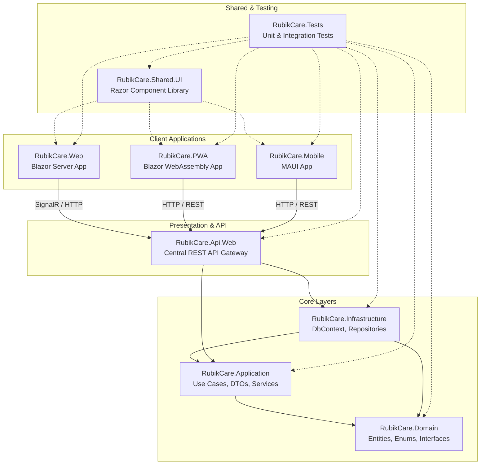
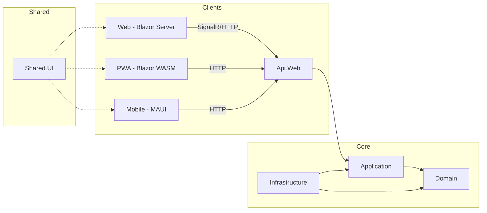

# 01 — ARCHITECTURE (الهيكل المعماري الشامل + Program.cs)

**الإصدار:** 2.0 (Unified Edition)
**آخر تحديث:** 16 أكتوبر 2026
**الحالة:** ✅ محدّث — يدمج 00 + 01 + 24
**الجمهور:** فريق التطوير + AI Assistants
**المرجع الإلزامي:** يُقرأ قبل أي تطوير جديد

---

## 📌 الجزء صفر: فلسفة البناء (نص المؤلف الحرفي)

> **⚠️ ملاحظة:**
> هذا القسم يحتوي على **نص الكاتب الحرفي** — دون إعادة صياغة.
> الهدف: حفظ الرؤية الكاملة كما صيغت.

نظام **RubikCare** هو منصة صحية متكاملة، صُممت لتوحيد إدارة المرضى، ومقدمي الرعاية (أطباء، صيادلة، مندوبين)، وبرامج الدعم (PSP) في منظومة رقمية واحدة. يعتمد النظام على **Clean Architecture** لضمان فصل واضح للمسؤوليات، وقابلية عالية للتطوير، وسهولة في الصيانة والاختبار.

تمتد المنصة عبر **تسعة مشاريع برمجية**، تنقسم إلى طبقات أساسية (Core) وتطبيقات طرفية (Clients)، جميعها تشترك في مكونات UI موحدة وتتواصل عبر واجهة برمجية (API) مركزية.

---

## 🗺️ الجزء الأول: الخريطة المعمارية للمشاريع التسعة

### 1.1 المخطط المعماري



### 1.2 الجدول التنفيذي للمشاريع

| المشروع | التقنية الأساسية | المسؤولية الرئيسية | يعتمد على (مباشر) |
| :--- | :--- | :--- | :--- |
| **Domain** | .NET 10 Class Library | الكيانات الأساسية، التعدادات، وواجهات النطاق المجردة. | لا يعتمد على أي مشروع. |
| **Application** | .NET 10 Class Library | منطق الأعمال، حالات الاستخدام (Use Cases)، وخدمات التطبيق. | `Domain` فقط. |
| **Infrastructure** | .NET 10, EF Core 10, SQL Server | تنفيذ واجهات الـ `Application`، الوصول للبيانات، الترحيلات (Migrations). | `Application` و `Domain`. |
| **Api.Web** | ASP.NET Core 10 | نقطة النهاية الموحدة (REST API) لجميع العملاء. | `Application` و `Infrastructure`. |
| **Web** | Blazor Server 10 | تطبيق الويب الرئيسي (تفاعلي مع SignalR). | `Api.Web` (ضمنياً) و `Shared.UI`. |
| **PWA** | Blazor WebAssembly 10 | تطبيق ويب تقدمي (نسخة كربونية من Mobile). | `Api.Web` (عبر HTTP) و `Shared.UI`. |
| **Mobile** | .NET MAUI 10 | تطبيق الهواتف الذكية (Android, iOS). | `Api.Web` (عبر HTTP) و `Shared.UI`. |
| **Shared.UI** | Razor Class Library (RCL) | مكونات Razor قابلة لإعادة الاستخدام + خدمات مشتركة. | لا يعتمد على تطبيقات محددة. |
| **Tests** | xUnit, Moq | اختبارات الوحدة والتكامل والمعمارية. | جميع المشاريع (حسب الحاجة). |

---

## 🧩 الجزء الثاني: مسؤوليات كل مشروع بالتفصيل

### 2.1 `RubikCare.Domain` — القلب النابض 🫀

**أكثر طبقة استقراراً ونقاءً.**

لا تعرف هذه الطبقة شيئاً عن قواعد البيانات، أو واجهات المستخدم، أو حتى كيفية نقل البيانات. همها الوحيد هو تمثيل مفاهيم العمل (Business Concepts).

- **المحتويات**: الكيانات (Entities) مثل `ApplicationUser`, `Patient`, `Medication`، التعدادات (Enums)، كائنات القيمة (Value Objects) كـ `Address`، وأحداث النطاق (Domain Events).
- **إضافة حديثة**: كيانات نظام النقاط (`PSPProgramPointScheme`, `PSPProgramPointRule`, إلخ).
- **قاعدة ذهبية**: **ممنوع** إضافة أي مرجعيات لـ Entity Framework أو مكتبات خارجية متعلقة بالبيانات.

### 2.2 `RubikCare.Application` — عقل النظام 🧠

**هنا يُتخذ القرار.**

تحتوي على حالات الاستخدام (Use Cases) التي تمثل متطلبات المستخدم الفعلية (مثل: `EnrollPatientInPspUseCase`). تقوم بتنسيق تدفق البيانات بين الـ `Api.Web` والـ `Infrastructure`، وتطبق منطق الأعمال.

- **المحتويات**: الخدمات (Services)، واجهات للبنية التحتية (Interfaces)، كائنات نقل البيانات (DTOs)، محولات (Mappers)، ومُحققّات (Validators) باستخدام FluentValidation.
- **إضافات حديثة**:
  - `PSPEnrollmentService` — تسجيل المرضى في برامج الدعم.
  - `PSPPointSchemeService` — قراءة نظام النقاط.
- **قاعدة ذهبية**: لا تعتمد إلا على `Domain` ولا تعرف كيف أو من أين تأتي البيانات (مستودع، خدمة خارجية، إلخ).

### 2.3 `RubikCare.Infrastructure` — الجسر إلى العالم الخارجي 🌉

**التفاصيل التقنية هنا.**

هذا هو مكان تنفيذ الواجهات المجردة التي عرّفها الـ `Application`. مسؤول عن التواصل مع قواعد البيانات، وإرسال البريد الإلكتروني، والخدمات السحابية.

- **المحتويات**: `BusinessDbContext` (EF Core)، تنفيذ المستودعات (Repositories)، ملفات الترحيل (Migrations)، وخدمات خارجية (مثل `EmailService`).
- **إضافات حديثة**:
  - **19 Handler** لنظام النقاط في `UseCases/PSP/Points/`.
  - **`PSPEnrollmentService`** في `Services/PSP/` (يستخدم `IGenericService<T>`).
- **قاعدة ذهبية**: يُسمح لها بالاعتماد على `Application` و `Domain` فقط، ولا يُستدعى مباشرة من قبل التطبيقات العميلة (Web, PWA, Mobile).

### 2.4 `RubikCare.Api.Web` — بوابة النظام الموحدة 🚪

**نقطة الدخول الوحيدة للبيانات.**

هي واجهة برمجية (REST API) مركزية تخدم جميع العملاء (Web, PWA, Mobile). تتولى المصادقة (JWT)، والتحقق من الصلاحيات، وتنسيق الطلبات.

- **المحتويات**: وحدات التحكم (Controllers)، `Program.cs`، وMiddleware (معالجة الأخطاء، التسجيل).
- **Controllers حديثة**:
  - `PointSchemesController` (4 endpoints)
  - `PointRulesController` (5 endpoints)
  - `PointBalancesController` (3 endpoints)
  - `PointEarningController` (1 endpoint)
  - `PointRedeemController` (5 endpoints)
- **قاعدة ذهبية**: وحدات التحكم يجب أن تكون **رفيعة جداً** (Thin Controllers)؛ كل المنطق يُفوض إلى الخدمات في طبقة `Application` أو إلى Handlers في `Infrastructure`.

### 2.5 `RubikCare.Web` — التطبيق التفاعلي الغني 💻

**تطبيق Blazor Server.**

يُستخدم في بيئات الإدارة واللوحات التي تتطلب تفاعلاً فورياً. يحافظ على اتصال مستمر (SignalR) مع الخادم، مما يوفر تجربة مستخدم سلسة.

- **المحتويات**: صفحات (Pages)، مكونات خاصة بالويب، وخدمات محلية لإدارة الحالة.
- **إضافات حديثة**:
  - **`PSPStep2b_PointScheme.razor`** — واجهة إدارة نظام النقاط للشركة.
  - **قسم "نظام النقاط"** في `PSPProgramsDetails.razor`.
- **قاعدة ذهبية**: يتواصل مع الـ `Api.Web` عبر HTTP، ولا يتفاعل مباشرة مع قواعد البيانات.

### 2.6 `RubikCare.PWA` — التطبيق الخفيف متعدد المنصات 📱

**تطبيق Blazor WebAssembly — نسخة كربونية من MAUI.**

تمت إضافته ليكون بديلاً لتطبيق الويب (Blazor Server) على الأجهزة التي لا تتعامل بكفاءة مع SignalR (مثل أجهزة iPhone)، وأيضاً ليكون حلاً سريعاً ومستقراً للوصول إلى النظام من أي متصفح.

- **طبيعة التشغيل**: يعمل كلياً داخل متصفح المستخدم بعد تحميل ملفات `WebAssembly`. يُنشر كملفات **ثابتة** (Static Files) على خادم ويب (مثل IIS).
- **المحتويات**:
  - صفحات Razor مكافئة لـ `RubikCare.Mobile`.
  - خدمات للتواصل مع الـ API (مثل `WebApiService`).
  - `googleAuth.js` — تكامل Google Identity Services.
  - `cache-reset.html` — لتنظيف Service Worker تلقائياً.
- **إضافات حديثة**:
  - **`PointDashboard.razor`** — محفظة النقاط.
- **الرابط المرجعي**: [دليل PWA](./14-PWA.md).

### 2.7 `RubikCare.Mobile` — تجربة الهواتف الذكية 📲

**تطبيق MAUI الأصلي.**

يستخدم `BlazorWebView` لعرض مكونات `Shared.UI`، مما يسمح بإعادة استخدام كبير للكود مع تطبيقات الويب. يوفر إمكانية الوصول إلى ميزات الجهاز (الكاميرا، GPS، الإشعارات المحلية).

- **المحتويات**: صفحات XAML، ViewModels، وخدمات خاصة بالمنصة (مثل `MauiLocalNotificationService`).
- **إضافات حديثة**:
  - **`PointsDashboardPage.xaml`** — Container لعرض `PointDashboard.razor`.
- **قاعدة ذهبية**: لا يعتمد على أي مشروع آخر باستثناء `Shared.UI`؛ يتواصل مع النظام حصراً عبر `Api.Web` باستخدام HTTP.

### 2.8 `RubikCare.Shared.UI` — مستودع المكونات المشتركة 🧩

**اللبنة الأساسية لواجهات المستخدم.**

مكتبة تحتوي على كل المكونات البصرية والخدمات المساعدة التي تستخدمها التطبيقات العميلة الثلاثة (Web, PWA, Mobile)، مما يضمن توحيد الشكل والأداء.

- **المحتويات**:
  - **68** مكون Razor (مثل `RubikSmartTable`, `RubikButton`).
  - **120+** ملف CSS منظم.
  - **25** خدمة/واجهة مشتركة (مثل `ITranslationService`).
- **إضافات حديثة**:
  - **`PointDashboard.razor`** + `PointDashboardNavigationBridge.cs` + `PointModels.cs`.
  - **`point-dashboard.css`**.
- **قاعدة ذهبية**: تحتوي على **مكونات** قابلة لإعادة الاستخدام، وليس صفحات كاملة، لتجنب تعقيد التبعيات.

### 2.9 `RubikCare.Tests` — شبكة الأمان الجودة 🛡️

**ضمان استقرار المعمارية.**

يحتوي على اختبارات الوحدة (Unit Tests) لكل طبقة، واختبارات تكامل (Integration Tests) بين الطبقات، بالإضافة إلى اختبارات معماريّة باستخدام `NetArchTest` للتأكد من عدم كسر قواعد التبعية.

- **عدد الاختبارات**: 33 اختبار ناجح (حتى الآن).
- **قاعدة ذهبية**: جزء لا يتجزأ من عملية التطوير.

---

## 🧭 الجزء الثالث: شجرة القرار المعماري (دليل المطور)

مع وجود ثلاثة تطبيقات عميلة وطبقات متعددة، قد يحتار المطور في النهج الصحيح لتطوير صفحة جديدة. هذا القسم يوفر إرشادات عملية.

### 3.1 مستويات "النقاء المعماري" (من العملي إلى النظري)

| المستوى | الوصف | النهج |
| :--- | :--- | :--- |
| **LVL 1** | **مقبول للصفحات القديمة جداً** (يُنصح بالترقية). | `Blazor Page` ← `DbContext` مباشرة. |
| **LVL 2** | **مناسب للعمليات البسيطة (CRUD)**. | `Blazor Page` ← `IGenericService<T>` ← `DbContext`. |
| **LVL 3** | **الموصى به للعمليات المعقدة والجديدة**. | `Blazor/MAUI/PWA Page` ← `UseCase` (في `Application`) ← `Repository` (في `Infrastructure`). |
| **LVL 4** | **الأنقى للعمليات المشتركة بين العملاء**. | `Client (Web/PWA/Mobile)` → (HTTP) → `Api.Web` → `UseCase`. |

### 3.2 القاعدة الذهبية: اختر النهج حسب التعقيد والمشاركة

| نوع الصفحة/الوظيفة | النهج الأمثل | مثال تطبيقي |
| :--- | :--- | :--- |
| **CRUD بسيط** (إضافة/تعديل/حذف لكيان واحد) | **LVL 2**: `IGenericService<T>` | عرض قائمة الأدوية، تعديل ملف المستخدم. |
| **منطق أعمال معقد** (متعدد الخطوات والشروط) | **LVL 3**: `UseCase` (في `Application`) | تسجيل مريض في برنامج دعم (PSP)، عملية مزامنة مع نظام خارجي. |
| **وظيفة مشتركة بين Web و PWA و Mobile** | **LVL 4**: `UseCase` (في `Application`) + `API` | إرسال إشعار، إنشاء تقرير، البحث المتقدم. |
| **عمليات حساسة جداً** (مالية، مصادقة) | **LVL 4**: `UseCase` + `API` مع تحقق إضافي (Validation). | معالجة الدفع، تغيير كلمة المرور. |
| **استعلامات تقارير معقدة** (قراءة فقط) | **استخدام** `DbContextFactoryService` مباشرة في الصفحة (مع الحذر). | لوحة التحكم (Dashboard) بإحصائيات متعددة. |

### 3.3 ⚠️ تحذيرات معمارية صارمة

- **لا تكسر تبعية الطبقات**: ممنوع استدعاء `Infrastructure` أو `DbContext` مباشرة من `Web` أو `PWA` أو `Mobile`.
- **الـ `API` للجميع**: تطبيقات `Mobile` و `PWA` **لا تعتمد** على أي مشروع آخر (`Domain`, `Application`...)، وتتواصل فقط مع `Api.Web` عبر HTTP.
- **`Shared.UI` للمكونات**: لا تضع صفحات كاملة (مثل `Dashboard.razor`) في `Shared.UI`، بل ضعها في المشاريع العميلة نفسها (`Web`, `PWA`, `Mobile`).
- **استخدم DTOs**: لا تُرجع كائنات `Domain` (Entities) مباشرة من الـ `API`، استخدم DTOs لمنع تسرب تفاصيل النطاق وتقليل حجم البيانات.

---

## 📋 الجزء الرابع: العلاقات والتبعيات (بصيغة مبسطة)



**خلاصة القاعدة**: السهم يشير إلى "يعتمد على". التطبيقات العميلة تعتمد على الـ API، والـ API يعتمد على الـ Application، والـ Application على الـ Domain، والـ Infrastructure على الـ Application والـ Domain. `Shared.UI` في المنتصف يستخدمه الجميع.

---

## 🔧 الجزء الخامس: Program.cs — مصدر الحقيقة الوحيد للتسجيلات

### 5.1 الغرض

هذا الملف هو **المصدر الوحيد** لكل الخدمات والإعدادات في النظام. أي خدمة تريد استخدامها في صفحتك **يجب** أن تكون مسجلة هنا.

### 5.2 منطقة الأساسيات ودعم SSR

```csharp
builder.Services.AddRazorComponents()
    .AddInteractiveServerComponents();
```

### 5.3 منطقة إدارة حالة المصادقة

```csharp
builder.Services.AddCascadingAuthenticationState();
builder.Services.AddScoped<IdentityRedirectManager>();
builder.Services.AddScoped<AuthenticationStateProvider, IdentityRevalidatingAuthenticationStateProvider>();

// تسجيل الدخول عبر Google
builder.Services.AddAuthentication()
    .AddGoogle(options =>
    {
        options.ClientId = googleClientId;
        options.ClientSecret = googleClientSecret;
    });
```

⚠️ **تحذير:** تأكد من وجود `ClientId` و `ClientSecret` في `appsettings.json`.

### 5.4 منطقة قاعدة البيانات (الأهم والأكثر خطأً)

```csharp
var connectionString = builder.Configuration.GetConnectionString("DefaultConnection");

// التسجيل القديم (للصفحات القديمة فقط)
builder.Services.AddDbContext<BusinessDbContext>(options =>
    options.UseSqlServer(connectionString),
    ServiceLifetime.Scoped);

// التسجيل الحديث والصحيح (للصفحات الجديدة)
builder.Services.AddDbContextFactory<BusinessDbContext>(options =>
    options.UseSqlServer(connectionString),
    ServiceLifetime.Scoped); // ⭐ هذا ما كان ناقصاً ويسبب أخطاء
```

**⚠️ تحذير حرج:**
- تأكد من وجود `ServiceLifetime.Scoped` في `AddDbContextFactory`
- لا تحذف `AddDbContext` إلا بعد ترحيل كل الصفحات القديمة
- `AddDbContextFactory` هو الموصى به للصفحات الجديدة لمنع مشكلة "A second operation started"

### 5.5 منطقة الهوية (Identity)

```csharp
builder.Services.AddIdentity<ApplicationUser, IdentityRole>(options =>
{
    options.Password.RequireDigit = false;
    options.Password.RequiredLength = 6;
    options.SignIn.RequireConfirmedAccount = false;
})
.AddEntityFrameworkStores<BusinessDbContext>()
.AddDefaultTokenProviders();

builder.Services.AddScoped<IGenericService<UserProfile>, GenericService<UserProfile>>();
builder.Services.AddScoped<IUserRoleService, UserRoleService>();
```

### 5.6 منطقة خدمات النظام الإضافية

```csharp
// الأداء
builder.Services.AddMemoryCache(); // ⭐ ضروري جداً للترجمة والقوائم

// حماية البيانات
builder.Services.AddDataProtection()
    .PersistKeysToFileSystem(new DirectoryInfo(Path.Combine(builder.Environment.ContentRootPath, "DataProtection-Keys")))
    .SetApplicationName("RubikCare");

// الخدمة الأساسية (CRUD)
builder.Services.AddScoped(typeof(IGenericService<>), typeof(GenericService<>));

// خدمات السياق والمساعدة (الأكثر استخداماً)
builder.Services.AddScoped<DbContextFactoryService>();
builder.Services.AddScoped<UserContextService>();
builder.Services.AddScoped<DynamicMenuService>();
builder.Services.AddScoped<IUserSessionService, UserSessionService>();
builder.Services.AddHttpContextAccessor();

// نظام الترجمة
builder.Services.AddScoped<LocalizationService>();
builder.Services.AddScoped<ILocalizationService, LocalizationService>();
builder.Services.AddScoped<TranslationStateService>();
builder.Services.AddScoped<ILayoutDirectionService, LayoutDirectionService>();

// خدمات Excel والصور
builder.Services.AddScoped<ExcelService>();
builder.Services.AddScoped<IImageService, ImageService>();
```

### 5.7 إعدادات Middleware (الترتيب مهم جداً)

```csharp
var app = builder.Build();

if (app.Environment.IsDevelopment())
{
    app.UseMigrationsEndPoint();
}
else
{
    app.UseExceptionHandler("/Error", createScopeForErrors: true);
    app.UseHsts();
}

app.UseStaticFiles(new StaticFileOptions
{
    FileProvider = new PhysicalFileProvider(
        Path.Combine(Directory.GetCurrentDirectory(), "wwwroot", "uploads")),
    RequestPath = "/uploads"
});

// ⭐ ترتيب Middleware إلزامي - لا تغيره أبداً
app.UseHttpsRedirection();
app.UseStaticFiles();
app.UseRouting();
app.UseAuthentication();    // ⭐ قبل Authorization
app.UseAuthorization();
app.UseAntiforgery();

// ضبط الثقافة الافتراضية
var defaultCulture = new CultureInfo("en");
CultureInfo.DefaultThreadCurrentCulture = defaultCulture;
CultureInfo.DefaultThreadCurrentUICulture = defaultCulture;

// ربط نقاط النهاية
app.MapAdditionalIdentityEndpoints();
app.MapRazorComponents<App>()
    .AddInteractiveServerRenderMode();

// API مخصص للترجمة
app.MapGet("/api/localization/page/{page}", async (
    string page,
    string lang,
    [FromServices] ILocalizationService locService) =>
{
    var translations = await locService.GetPageTranslationsAsync(page, lang);
    return Results.Ok(translations);
});

app.Run();
```

⚠️ **ترتيب Middleware إلزامي:** يجب أن يكون `UseAuthentication` قبل `UseAuthorization`. أي تبديل يؤدي إلى فشل المصادقة.

---

## 📄 الجزء السادس: App.razor — تدفق التطبيق

### 6.1 الكود الكامل

```razor
<Router AppAssembly="@typeof(App).Assembly">
    <Found Context="routeData">
        <RouteView RouteData="@routeData" DefaultLayout="@typeof(MainLayout)" />
        <FocusOnNavigate RouteData="@routeData" Selector="h1" />
    </Found>
    <NotFound>
        <PageTitle>الصفحة غير موجودة</PageTitle>
        <LayoutView Layout="@typeof(MainLayout)">
            <div class="text-center py-5">
                <h1>404</h1>
                <p>عذراً، الصفحة التي تبحث عنها غير موجودة.</p>
                <NavLink href="/">العودة للرئيسية</NavLink>
            </div>
        </LayoutView>
    </NotFound>
</Router>

@code {
    [Inject] private TranslationStateService TranslationState { get; set; }
    [Inject] private LayoutDirectionService LayoutDirection { get; set; }

    protected override async Task OnInitializedAsync()
    {
        // ⭐ مهم جداً: تهيئة اللغة قبل أي شيء
        await TranslationState.InitializeAsync();
        await LayoutDirection.EnsureInitializedAsync();
    }
}
```

### 6.2 النقاط الحرجة

- **التهيئة المبكرة للغة:** بدون استدعاء `TranslationState.InitializeAsync()` هنا، ستعرض الصفحة الأولى اللغة الافتراضية ثم "تومض" عند تحميل اللغة الحقيقية.
- **التوجيه الموحد:** `DefaultLayout="@typeof(MainLayout)"` يضمن أن كل الصفحات ترث التخطيط نفسه.

---
## 🔗 الجزء السادس-ب: Integration Contracts (عقود التكامل)

### 📌 الغرض

كل تكامل بين نظامين في RubikCare يجب أن يكون مكتوباً هنا كـ "عقد" (Contract) — يحدد:
- **From → To**: أي نظام يُطلق الحدث؟
- **Event**: ما هو الحدث؟
- **Method**: ما الدالة المسؤولة؟
- **Reference**: كيف تُربط المعاملة بالحدث الأصلي؟
- **Idempotency**: كيف نمنع التكرار؟
- **Status**: ما حالة التنفيذ؟

**القاعدة الذهبية:** لا تكامل بدون عقد موثق هنا.

### 📊 جدول العقود

| # | From → To | Event | Method | Reference | Idempotency | Status |
|---|-----------|-------|--------|-----------|-------------|--------|
| **IC-01** | PSP → Points | DispensationCompleted | `IEarnPointsOrchestrator.AwardByCampaignAsync` | `DISPENSATION/{DispensationID}` | ⚠️ يحتاج | 🟡 يعمل بدون Idempotency |
| **IC-02** | PSP → Points | RefillCompleted | (نفس IC-01) | (نفس IC-01) | ⚠️ يحتاج | 🟡 |
| **IC-03** | Reminders → Points | DailyDoseTaken | `AwardByCampaignAsync` | `SCHEDULE/{ScheduleID}` | ⚠️ يحتاج | 🟡 |
| **IC-04** | PSP → Points | PointsRedeem | `GenerateNextToken` | `DISPENSATION/{DispensationID}` | ❌ | 🔴 **مكسور** |
| **IC-05** | Points → Notifications | PointsEarned | `SendPointsEarnedNotification` | `TRANSACTION/{TransactionID}` | N/A | ⏳ Sprint 1 |
| **IC-06** | Points → Notifications | PointsRedeemed | `SendPointsRedeemedNotification` | `TRANSACTION/{TransactionID}` | N/A | ⏳ Sprint 1 |
| **IC-07** | Points → Reports | AdherencePoints | تحديث `GetAdherenceHandler` | — | N/A | ⏳ Sprint 1 |
| **IC-08** | Points → Reports | FinancialWithPoints | تحديث `GetPharmacyFinancialHandler` | — | N/A | ⏳ Sprint 1 |
| **IC-09** | Points → Reports | ProgramLifecyclePoints | تحديث `GetProgramLifecycleHandler` | — | N/A | ⏳ Sprint 1 |

### 📝 تفاصيل كل عقد

#### IC-01: PSP → Points (DispensationCompleted)

**الحدث:** تأكيد صرف دواء من الصيدلي.
**المكان:** `DispenseController.ConfirmDispense` + `DispenseController.ScanAndDispense`.
**Method:**
```csharp
await TryAwardPointsViaOrchestratorAsync(
    patientId: eRx.PatientID,
    programId: eRx.ProgramID,
    activityTypeId: dispensation.RefillNumber > 0 
        ? PointActivityTypeIds.RefillCompleted 
        : PointActivityTypeIds.DispensationCompleted,
    referenceType: "DISPENSATION",
    referenceId: dispensation.DispensationID,
    currentUserId: pharmacistId);

Idempotency: فحص مسبق قبل الاستدعاء:

```csharp
var exists = await db.Set<PSPProgramPointTransaction>()
    .AnyAsync(t => t.ReferenceType == "DISPENSATION" 
               && t.ReferenceID == dispensation.DispensationID
               && t.TransactionTypeID == PointTransactionTypeIds.Earn);
if (exists) return;
IC-02: PSP → Points (RefillCompleted)
الحدث: تأكيد صرف دواء (Refill > 0).
المكان: (نفس IC-01).
Method: (نفس IC-01، مع activityTypeId = PointActivityTypeIds.RefillCompleted).
Idempotency: (نفس IC-01).

IC-03: Reminders → Points (DailyDoseTaken)
الحدث: تأكيد تناول جرعة يومية.
المكان: AcknowledgeReminderHandler.HandleAsync → TryAwardDailyDosePointsAsync.
Method:

```csharp
await _pointsOrchestrator.AwardByCampaignAsync(
    campaignId: programId,
    pointSystemTypeID: 1,
    activityTypeId: PointActivityTypeIds.DailyDoseTaken,
    context: new PointsContext { ... },
    referenceType: "SCHEDULE",
    referenceId: scheduleId,
    currentUserId: null);
Idempotency: فحص مسبق:

```csharp
var exists = await db.Set<PSPProgramPointTransaction>()
    .AnyAsync(t => t.ReferenceType == "SCHEDULE" 
               && t.ReferenceID == scheduleId
               && t.TransactionTypeID == PointTransactionTypeIds.Earn);
if (exists) return;
IC-04: PSP → Points (PointsRedeem) — 🔴 Sprint 1
الحدث: تجديد توكن مع PointsToRedeem > 0.
المكان: DispenseController.GenerateNextToken.
Method: (يُنفذ داخل Transaction واحد — انظر تفاصيل التنفيذ في Sprint 1).
Idempotency: فحص ReferenceType="DISPENSATION" && ReferenceID=DispensationID && TransactionTypeID=REDEEM_DISPENSATION.
Reference:

```csharp
var redemptionTransaction = new PSPProgramPointTransaction
{
    BalanceID = dbBalance.BalanceID,
    TransactionTypeID = PointTransactionTypeIds.RedeemDispensation,  // 9
    Points = -pointsToRedeem,
    BalanceBefore = balanceBefore,
    BalanceAfter = balanceAfter,
    ReferenceType = "DISPENSATION",
    ReferenceID = newDispensation.DispensationID,
    Description = $"خصم نقاط على التوكن {newTokenCode}",
    CreatedBy = userId,
    CreatedDate = DateTime.UtcNow
};
IC-05: Points → Notifications (PointsEarned) — ⏳ Sprint 1
الحدث: كسب نقاط (من أي Handler).
المكان: Helper SendPointsEarnedNotification يُستدعى من IEarnPointsOrchestrator.
الرسالة: "🎉 كسبت X نقطة من [نشاط]".
Idempotency: N/A (إشعار قد يتكرر — مقبول).

IC-06: Points → Notifications (PointsRedeemed) — ⏳ Sprint 1
الحدث: خصم نقاط (من GenerateNextToken).
المكان: DispenseController.GenerateNextToken → بعد Commit الناجح.
الرسالة: "💎 استخدمت X نقطة كخصم على توكنك (بقيمة Y ج.م)".
Idempotency: N/A.

IC-07: Points → Reports (AdherencePoints) — ⏳ Sprint 1
الحدث: طلب تقرير الالتزام.
المكان: GetAdherenceHandler.HandleAsync.
الإضافة: لكل AdherencePatientDto إضافة PointsEarned, PointsRedeemed, CurrentBalance.
المصدر: PSPProgramPointBalance + PSPProgramPointTransaction.

IC-08: Points → Reports (FinancialWithPoints) — ⏳ Sprint 1
الحدث: طلب تقرير مالي للصيدلية.
المكان: GetPharmacyFinancialHandler.HandleAsync.
الإضافة: لكل Dispensation تمييز:

ProgramDiscount (من PlanMedication.DiscountPercentage).

PointsDiscount (من PSPProgramPointTransaction حيث TransactionTypeID=REDEEM_DISPENSATION).
الحقول الجديدة: TotalPointsDiscount, TotalReimbursement (معدل).

IC-09: Points → Reports (ProgramLifecyclePoints) — ⏳ Sprint 1
الحدث: طلب تقرير دورة حياة البرنامج.
المكان: GetProgramLifecycleHandler.HandleAsync.
الإضافة:

TotalPointsEarned (مجموع EARN).

TotalPointsRedeemed (مجموع REDEEM_DISPENSATION).

TotalPointsInCirculation (مجموع Balance).

ActivePointsUsers (عدد المرضى الذين لديهم رصيد > 0).

🚨 قواعد إلزامية
كل تكامل جديد يجب أن يضاف إلى الجدول.
كل عقد يجب أن يُوثَّق قبل التنفيذ.

Idempotency إلزامي لأي تكامل يخصم/يمنح نقاط.
Reference Type يجب أن يكون واضحاً (DISPENSATION, SCHEDULE, CONTENT, إلخ).
Reference ID يجب أن يكون int (معرّف الكيان).
لا تكامل مباشر بين نظامين بدون Orchestrator/Service.


## 🎯 الجزء السابع: مصفوفة اختيار الخدمة

### 7.1 لماذا هذا القسم مهم؟

في المشروع الحالي، يوجد عدة طرق للوصول إلى البيانات. السؤال الأكثر تكراراً من المطورين الجدد هو: **"أي خدمة أستخدم لصفحتي الجديدة؟"**. هذا القسم يجيب على هذا السؤال بشكل قاطع.

### 7.2 📊 المصفوفة الكاملة للخدمات

#### 7.2.1 خدمات أساسية (ضرورية لكل صفحة)

| الخدمة | الواجهة | متى تستخدمها؟ | مثال |
|--------|---------|---------------|------|
| `GenericService<T>` | `IGenericService<T>` | **CRUD بسيط** على كيان واحد (عرض/إضافة/تعديل/حذف) | قائمة الأدوية، تعديل اسم منظمة |
| `DbContextFactoryService` | - | **استعلامات قراءة مخصصة** معقدة (تقارير، فلترة متعددة) | لوحة التحكم، تقارير المبيعات |
| `UserContextService` | `IUserContextService` | **معلومات المستخدم الحالي** (ID، الأدوار، الصلاحيات) | أي صفحة تحتاج معرفة من هو المسجل |

#### 7.2.2 خدمات الترجمة (لأي صفحة تدعم اللغتين)

| الخدمة | الواجهة | متى تستخدمها؟ | مثال |
|--------|---------|---------------|------|
| `TranslationStateService` | - | معرفة **اللغة الحالية** والاشتراك في تغييراتها | أي صفحة تدعم AR/EN |
| `ILocalizationService` | `ILocalizationService` | جلب **الترجمات من قاعدة البيانات** | عرض النصوص المترجمة |
| `LayoutDirectionService` | `ILayoutDirectionService` | إدارة **اتجاه الصفحة** (RTL/LTR) | ضبط `dir` attribute |

#### 7.2.3 خدمات المستخدم والسياق

| الخدمة | الواجهة | متى تستخدمها؟ | مثال |
|--------|---------|---------------|------|
| `UserContextService` | `IUserContextService` | ID المستخدم، الأدوار، الصلاحيات | التحقق من صلاحية الوصول |
| `IUserSessionService` | `IUserSessionService` | localStorage + إدارة الجلسات | حفظ تفضيلات الجلسة |
| `IUserRoleService` | `IUserRoleService` | **إدارة الأدوار الموسعة** (AspNetUserRoles) | إضافة/تعديل/حذف أدوار المستخدمين |

#### 7.2.4 خدمات التنقل والقوائم

| الخدمة | الواجهة | متى تستخدمها؟ | مثال |
|--------|---------|---------------|------|
| `DynamicMenuService` | - | جلب **القوائم الديناميكية** للمستخدم | عرض القائمة الجانبية |

#### 7.2.5 خدمات مساعدة

| الخدمة | الواجهة | متى تستخدمها؟ | مثال |
|--------|---------|---------------|------|
| `ExcelService` | `IExcelService<T>` | استيراد/تصدير Excel | تصدير قائمة مرضى |
| `IImageService` | `IImageService` | رفع ومعالجة الصور | رفع صورة البروفايل |


---

## 📄 الجزء الثالث: Migration — إضافة `REDEEM_DISPENSATION` (ID=9)

**ملف جديد:** `RubikCare.Infrastructure/Migrations/20261020_AddRedeemDispensationTransactionType.cs`

**⚠️ ملاحظة:** Migration تُولَّد عبر `dotnet ef migrations add`. لكن بما أننا نضيف SQL يدوي، سأستخدم `migrationBuilder.Sql`.

```csharp
using Microsoft.EntityFrameworkCore.Migrations;

#nullable disable

namespace RubikCare.Infrastructure.Migrations
{
    /// <summary>
    /// Sprint 1 — IC-04: إضافة نوع معاملة REDEEM_DISPENSATION (ID=9)
    /// لتمييز خصم النقاط على الصرف عن طلبات الاسترداد (REDEEM_REQUEST).
    /// </summary>
    public partial class AddRedeemDispensationTransactionType : Migration
    {
        protected override void Up(MigrationBuilder migrationBuilder)
        {
            migrationBuilder.Sql(@"
                SET IDENTITY_INSERT PSPProgramPointTransactionTypes ON;
                
                IF NOT EXISTS (SELECT 1 FROM PSPProgramPointTransactionTypes WHERE TransactionTypeID = 9)
                BEGIN
                    INSERT INTO PSPProgramPointTransactionTypes 
                        (TransactionTypeID, TransactionTypeCode, NameAr, NameEn, Description, 
                         IsSystem, IsActive, DisplayOrder, CreatedDate)
                    VALUES 
                        (9, N'REDEEM_DISPENSATION', N'خصم على الصرف', N'Redeem on Dispensation', 
                         N'خصم نقاط مباشر على صرف الدواء (عند تجديد التوكن)', 
                         1, 1, 9, GETDATE());
                END
                
                SET IDENTITY_INSERT PSPProgramPointTransactionTypes OFF;
            ");
        }

        protected override void Down(MigrationBuilder migrationBuilder)
        {
            migrationBuilder.Sql(@"
                DELETE FROM PSPProgramPointTransactionTypes 
                WHERE TransactionTypeID = 9 
                  AND TransactionTypeCode = N'REDEEM_DISPENSATION';
            ");
        }
    }
}

---
📄 الجزء الرابع: تحديث PointTransactionTypeIds.cs
مكان التعديل: في ملف RubikCare.Domain/Constants/PSP/Points/PointTransactionTypeIds.cs.

الجزء قبل التعديل:

```csharp

public static class PointTransactionTypeIds
{
    public const int Earn = 1;
    public const int RedeemRequest = 2;
    public const int RedeemAccepted = 3;
    // ...
}
الجزء بعد التعديل:

```csharp

public static class PointTransactionTypeIds
{
    public const int Earn = 1;
    public const int RedeemRequest = 2;
    public const int RedeemAccepted = 3;
    public const int RedeemRejected = 4;
    public const int RedeemConfirmed = 5;
    public const int RedeemDisputed = 6;
    public const int RedeemResolvedCompleted = 7;
    public const int RedeemResolvedRejected = 8;
    
    /// <summary>
    /// ⭐ Sprint 1 — IC-04: خصم نقاط على الصرف (عند تجديد التوكن).
    /// يُنشأ من GenerateNextToken — ويُربط بـ ReferenceType="DISPENSATION".
    /// </summary>
    public const int RedeemDispensation = 9;
}
📄 الجزء الخامس: تحديث PatientProgramDetailsResponse.cs
مكان التعديل: في RubikCare.Application/DTOs/PSP/PatientProgramDetailsResponse.cs — بعد PointsUsedInCurrentToken.

الجزء قبل التعديل:

```csharp

        public int TotalDosesToday { get; set; }
        public bool PointsUsedInCurrentToken { get; set; }

    }
الجزء بعد التعديل:

```csharp

        public int TotalDosesToday { get; set; }
        public bool PointsUsedInCurrentToken { get; set; }

        // ═══════════════════════════════════════════════════════════
        // ⭐ Sprint 1 — IC-04: MonetaryValuePerPoint (لعرض قيمة الخصم)
        // ═══════════════════════════════════════════════════════════

        /// <summary>
        /// القيمة المادية للنقطة الواحدة (بالجنيه المصري).
        /// تُستخدم في PspDetailComponent لعرض "قيمة الخصم المتوقعة".
        /// تُجلب من PSPProgramPointScheme.MonetaryValuePerPoint.
        /// </summary>
        public decimal MonetaryValuePerPoint { get; set; }

        /// <summary>
        /// الحد الأدنى للنقاط لاستخدام "استخدم نقاطي".
        /// NULL = لا يوجد حد.
        /// تُجلب من PSPProgramPointScheme.MinimumRedeemPoints.
        /// </summary>
        public decimal? MinimumRedeemPoints { get; set; }

        /// <summary>
        /// الحد الأقصى للنقاط في عملية واحدة.
        /// NULL = لا يوجد حد.
        /// تُجلب من PSPProgramPointScheme.MaximumRedeemPoints.
        /// </summary>
        public decimal? MaximumRedeemPoints { get; set; }

    }
📄 الجزء السادس: إعادة كتابة GenerateNextToken (IC-04) — الجزء الحرج
مكان التعديل: في Api.Web/Controllers/Pharmacy/DispenseController.cs.

الجزء قبل التعديل (بالتحديد — من بداية الـ Endpoint حتى نهايته):

```csharp

    // ═══════════════════════════════════════════════════════════
    // 7. توليد Token جديد يدوياً
    // ═══════════════════════════════════════════════════════════
    [HttpPost("generate-next-token")]
    [Authorize]
    public async Task<ActionResult<GenerateNextTokenResponse>> GenerateNextToken([FromBody] GenerateNextTokenRequest request)
    {
        try
        {
            var userId = GetCurrentUserId();
            if (userId == null)
                return Unauthorized(new { Success = false, Message = "الرجاء تسجيل الدخول" });

            _logger.LogInformation($"🔵 GenerateNextToken: PatientId={request.PatientId}, ProgramId={request.ProgramId}");

            var eRxList = await _eRxService.GetAllAsync(
                filter: e => e.PatientID == request.PatientId && e.Status == "ACTIVE",
                autoInclude: false
            );
            var eRx = eRxList.FirstOrDefault();

            if (eRx == null)
            {
                _logger.LogWarning($"⚠️ No active ERx for PatientId={request.PatientId}");
                return BadRequest(new GenerateNextTokenResponse { Success = false, Message = "لا يوجد وصفة طبية نشطة" });
            }

            var plans = await _planService.GetAllAsync(
                filter: p => p.ProgramID == request.ProgramId && p.IsActive,
                autoInclude: false
            );
            var plan = plans.FirstOrDefault();

            if (plan == null)
            {
                _logger.LogError($"❌ No active Plan for ProgramID={request.ProgramId}");
                return BadRequest(new GenerateNextTokenResponse { Success = false, Message = "لا توجد خطة صرف نشطة لهذا البرنامج" });
            }

            if (plan.IsSingleDispense)
            {
                return BadRequest(new GenerateNextTokenResponse { Success = false, Message = "خطة الصرف مرة واحدة فقط - لا يمكن توليد رمز جديد" });
            }

            if (!plan.AllowRefills)
            {
                return BadRequest(new GenerateNextTokenResponse { Success = false, Message = "إعادة الصرف غير مسموح بها في هذه الخطة" });
            }

            var existingDispensations = await _dispensationService.GetAllAsync(
                filter: d => d.ERxID == eRx.ERxID,
                orderBy: q => q.OrderByDescending(d => d.RefillNumber),
                autoInclude: false
            );
            var lastDispensation = existingDispensations.FirstOrDefault();
            var refillNumber = (lastDispensation?.RefillNumber ?? 0) + 1;

            if (plan.MaxRefills > 0 && refillNumber > plan.MaxRefills)
            {
                return BadRequest(new GenerateNextTokenResponse { Success = false, Message = $"وصلت للحد الأقصى للصرف ({plan.MaxRefills} مرات)" });
            }

            var activeTokens = await _dispensationService.GetAllAsync(
                filter: d => d.ERxID == eRx.ERxID &&
                             d.TokenUsed == false &&
                             d.TokenExpiryDate > DateTime.UtcNow,
                autoInclude: false
            );

            if (activeTokens.Any())
            {
                var activeToken = activeTokens.First();
                return BadRequest(new GenerateNextTokenResponse
                {
                    Success = false,
                    Message = $"يوجد رمز نشط بالفعل: {activeToken.TokenCode} (صالح حتى {activeToken.TokenExpiryDate:yyyy/MM/dd})",
                    ExistingToken = activeToken.TokenCode
                });
            }

            var daysBetween = plan.DaysBetweenRefills ?? 30;
            var daysBetweenHours = daysBetween * 24;
            var validityHours = Math.Max(daysBetweenHours, plan.TokenValidityHours ?? 24);
            var datePart = DateTime.UtcNow.ToString("yyyyMMdd");
            var randomPart = new Random().Next(1000, 9999);
            var newTokenCode = $"RC-{datePart}-{randomPart}";
            var newDispensationCode = $"DISP-{DateTime.UtcNow:yyyyMMdd}-{Guid.NewGuid().ToString("N").Substring(0, 6).ToUpper()}";

            var newDispensation = new PSPDispensation
            {
                DispensationCode = newDispensationCode,
                ERxID = eRx.ERxID,
                PlanID = plan.PlanID,
                TokenCode = newTokenCode,
                TokenGeneratedDate = DateTime.UtcNow,
                TokenExpiryDate = DateTime.UtcNow.AddHours(validityHours),
                TokenUsed = false,
                Status = "GENERATED",
                RefillNumber = refillNumber,
                QuantityDispensed = 0,
                IsEarlyRequest = false,
                CreatedDate = DateTime.UtcNow
            };

            await _dispensationService.AddAsync(newDispensation);
            await _dispensationService.SaveChangesAsync();

            _logger.LogInformation($"✅ Manual Token Generated: {newTokenCode} | Refill: {refillNumber} | Valid Hours: {validityHours}");

            // ⭐ بعد حفظ التوكن الجديد في قاعدة البيانات (بعد SaveChangesAsync)

            if (request.PointsToRedeem > 0)
            {
                // 1. جلب رصيد النقاط الحالي للمريض
                var balance = await _dbFactory.ExecuteReadOnlyAsync(async ctx =>
                {
                    var db = (DbContext)ctx;
                    return await db.Set<PSPProgramPointBalance>()
                        .FirstOrDefaultAsync(b => b.BeneficiaryTypeID == 5 && b.BeneficiaryID == request.PatientId);
                });

                if (balance != null && balance.Balance >= request.PointsToRedeem)
                {
                    // 2. خصم النقاط من الرصيد
                    var monetaryValue = request.PointsToRedeem * balance.Scheme.MonetaryValuePerPoint;

                    // 3. إضافة الخصم إلى التوكن الجديد (في الذاكرة)
                    newDispensation.PSPCoverage = (newDispensation.PSPCoverage ?? 0) + monetaryValue;
                    newDispensation.PatientPayment = (newDispensation.PatientPayment ?? 0) - monetaryValue;

                    // 4. تحديث قاعدة البيانات (الرصيد + المعاملة + التوكن) في سياق واحد
                    await _dbFactory.ExecuteWithNewContextAsync(async ctx =>
                    {
                        var db = (DbContext)ctx;

                        // 4.1 تحديث الرصيد
                        var dbBalance = await db.Set<PSPProgramPointBalance>()
                            .FirstOrDefaultAsync(b => b.BalanceID == balance.BalanceID);

                        if (dbBalance != null)
                        {
                            dbBalance.Balance -= request.PointsToRedeem;
                            dbBalance.TotalRedeemed += request.PointsToRedeem;
                            dbBalance.LastRedeemDate = DateTime.UtcNow;
                            dbBalance.LastUpdatedDate = DateTime.UtcNow;

                            // 4.2 تسجيل معاملة النقاط
                            var transaction = new PSPProgramPointTransaction
                            {
                                BalanceID = dbBalance.BalanceID,
                                TransactionTypeID = 2, // REDEEM
                                Points = -request.PointsToRedeem,
                                BalanceBefore = dbBalance.Balance + request.PointsToRedeem,
                                BalanceAfter = dbBalance.Balance,
                                Description = $"خصم إضافي على صرف الدواء (توكن: {newDispensation.TokenCode})",
                                CreatedDate = DateTime.UtcNow
                            };
                            db.Set<PSPProgramPointTransaction>().Add(transaction);
                        }

                        // 4.3 تحديث التوكن الجديد (PSPDispensation)
                        var dbDispensation = await db.Set<PSPDispensation>()
                            .FirstOrDefaultAsync(d => d.DispensationID == newDispensation.DispensationID);

                        if (dbDispensation != null)
                        {
                            dbDispensation.PSPCoverage = newDispensation.PSPCoverage;
                            dbDispensation.PatientPayment = newDispensation.PatientPayment;
                        }

                        await db.SaveChangesAsync();
                    });

                    _logger.LogInformation($"✅ تم خصم {request.PointsToRedeem} نقطة من رصيد المريض، بقيمة {monetaryValue} ج.م");
                }
                else
                {
                    _logger.LogWarning($"⚠️ رصيد غير كافٍ. المطلوب: {request.PointsToRedeem}، المتاح: {balance?.Balance ?? 0}");
                }
            }


            return Ok(new GenerateNextTokenResponse
            {
                Success = true,
                Message = "تم توليد رمز صرف جديد بنجاح",
                TokenCode = newTokenCode,
                ExpiryDate = newDispensation.TokenExpiryDate ?? DateTime.UtcNow.AddHours(24),
                RefillNumber = refillNumber,
                RemainingRefills = plan.MaxRefills > 0 ? plan.MaxRefills - refillNumber : null
            });
        }
        catch (Exception ex)
        {
            _logger.LogError(ex, "❌ GenerateNextToken error");
            return StatusCode(500, new GenerateNextTokenResponse { Success = false, Message = "حدث خطأ داخلي" });
        }
    }
الجزء بعد التعديل (النسخة الجديدة الكاملة):

```csharp

    // ═══════════════════════════════════════════════════════════
    // 7. توليد Token جديد يدوياً (Sprint 1 — IC-04: إعادة كتابة ذرية)
    //
    // التغييرات الجوهرية:
    //   ✅ Transaction ذري واحد (يمنع ضياع النقاط عند فشل تحديث Dispensation)
    //   ✅ TransactionTypeID = RedeemDispensation (9) بدلاً من 2
    //   ✅ ReferenceType = "DISPENSATION" + ReferenceID = DispensationID
    //   ✅ Idempotency (لا خصم مكرر لنفس التوكن)
    //   ✅ Balance يُفلتر بـ SchemeID (من ProgramID)
    //   ✅ السعر المبدئي (TotalAmount) يُملأ عند التوليد
    //   ✅ إشعار المريض عند الخصم (IC-06)
    //   ✅ يستخدم قاعدة AcceptRedeemRequestHandler (النموذج المثالي)
    // ═══════════════════════════════════════════════════════════
    [HttpPost("generate-next-token")]
    [Authorize]
    public async Task<ActionResult<GenerateNextTokenResponse>> GenerateNextToken([FromBody] GenerateNextTokenRequest request)
    {
        try
        {
            var userId = GetCurrentUserId();
            if (userId == null)
                return Unauthorized(new GenerateNextTokenResponse { Success = false, Message = "الرجاء تسجيل الدخول" });

            _logger.LogInformation(
                "🔵 GenerateNextToken: PatientId={PatientId}, ProgramId={ProgramId}, PointsToRedeem={Points}",
                request.PatientId, request.ProgramId, request.PointsToRedeem);

            // ═══ 1. Pre-Validation (قراءة فقط — خارج Transaction) ═══
            var eRx = (await _eRxService.GetAllAsync(
                filter: e => e.PatientID == request.PatientId && e.Status == "ACTIVE",
                autoInclude: false)).FirstOrDefault();

            if (eRx == null)
                return BadRequest(new GenerateNextTokenResponse { Success = false, Message = "لا يوجد وصفة طبية نشطة" });

            var plan = (await _planService.GetAllAsync(
                filter: p => p.ProgramID == request.ProgramId && p.IsActive,
                autoInclude: false)).FirstOrDefault();

            if (plan == null)
                return BadRequest(new GenerateNextTokenResponse { Success = false, Message = "لا توجد خطة صرف نشطة لهذا البرنامج" });

            if (plan.IsSingleDispense)
                return BadRequest(new GenerateNextTokenResponse { Success = false, Message = "خطة الصرف مرة واحدة فقط - لا يمكن توليد رمز جديد" });

            if (!plan.AllowRefills)
                return BadRequest(new GenerateNextTokenResponse { Success = false, Message = "إعادة الصرف غير مسموح بها في هذه الخطة" });

            // ═══ 2. جلب الـ Scheme (لعزل النقاط في السياق الصحيح — IC-04) ═══
            PSPProgramPointScheme? scheme = null;
            PSPProgramPointBalance? balanceSnapshot = null;

            if (request.PointsToRedeem > 0)
            {
                scheme = await _dbFactory.ExecuteReadOnlyAsync(async ctx =>
                {
                    var db = (DbContext)ctx;
                    return await db.Set<PSPProgramPointScheme>()
                        .AsNoTracking()
                        .Where(s => s.SourceEntityID == request.ProgramId
                                 && s.PointSystemTypeID == 1
                                 && s.IsActive)
                        .FirstOrDefaultAsync();
                });

                if (scheme == null)
                    return BadRequest(new GenerateNextTokenResponse { Success = false, Message = "لا يوجد نظام نقاط نشط لهذا البرنامج" });

                // التحقق من الحد الأدنى/الأقصى
                if (scheme.MinimumRedeemPoints.HasValue && request.PointsToRedeem < scheme.MinimumRedeemPoints.Value)
                    return BadRequest(new GenerateNextTokenResponse { Success = false, Message = $"الحد الأدنى لاستخدام النقاط {scheme.MinimumRedeemPoints.Value} نقطة" });

                if (scheme.MaximumRedeemPoints.HasValue && request.PointsToRedeem > scheme.MaximumRedeemPoints.Value)
                    return BadRequest(new GenerateNextTokenResponse { Success = false, Message = $"الحد الأقصى لاستخدام النقاط {scheme.MaximumRedeemPoints.Value} نقطة" });

                // جلب الرصيد المبدئي
                balanceSnapshot = await _dbFactory.ExecuteReadOnlyAsync(async ctx =>
                {
                    var db = (DbContext)ctx;
                    return await db.Set<PSPProgramPointBalance>()
                        .AsNoTracking()
                        .FirstOrDefaultAsync(b => b.BeneficiaryTypeID == 5
                                               && b.BeneficiaryID == request.PatientId
                                               && b.SchemeID == scheme.SchemeID
                                               && b.IsActive);
                });

                if (balanceSnapshot == null)
                    return BadRequest(new GenerateNextTokenResponse { Success = false, Message = "لا يوجد رصيد نقاط لهذا البرنامج" });

                if (balanceSnapshot.Balance < request.PointsToRedeem)
                    return BadRequest(new GenerateNextTokenResponse { Success = false, Message = $"رصيد غير كافٍ (المتاح: {balanceSnapshot.Balance})" });
            }

            // ═══ 3. فحص التوكنات النشطة (لمنع التكرار) ═══
            var activeTokens = await _dispensationService.GetAllAsync(
                filter: d => d.ERxID == eRx.ERxID
                          && d.TokenUsed == false
                          && d.TokenExpiryDate > DateTime.UtcNow,
                autoInclude: false);

            if (activeTokens.Any())
            {
                var active = activeTokens.First();
                return BadRequest(new GenerateNextTokenResponse
                {
                    Success = false,
                    Message = $"يوجد رمز نشط بالفعل: {active.TokenCode} (صالح حتى {active.TokenExpiryDate:yyyy/MM/dd})",
                    ExistingToken = active.TokenCode
                });
            }

            // ═══ 4. تجهيز البيانات (قراءة فقط) ═══
            var lastDispensation = (await _dispensationService.GetAllAsync(
                filter: d => d.ERxID == eRx.ERxID,
                orderBy: q => q.OrderByDescending(d => d.RefillNumber),
                autoInclude: false)).FirstOrDefault();

            var refillNumber = (lastDispensation?.RefillNumber ?? 0) + 1;

            if (plan.MaxRefills > 0 && refillNumber > plan.MaxRefills)
                return BadRequest(new GenerateNextTokenResponse { Success = false, Message = $"وصلت للحد الأقصى للصرف ({plan.MaxRefills} مرات)" });

            var daysBetween = plan.DaysBetweenRefills ?? 30;
            var validityHours = Math.Max(daysBetween * 24, plan.TokenValidityHours ?? 24);
            var newTokenCode = $"RC-{DateTime.UtcNow:yyyyMMdd}-{new Random().Next(1000, 9999)}";
            var newDispensationCode = $"DISP-{DateTime.UtcNow:yyyyMMdd}-{Guid.NewGuid().ToString("N").Substring(0, 6).ToUpper()}";

            // ═══ 5. جلب سعر الوحدة (لعرض السعر المبدئي — حل مشكلة NULL) ═══
            decimal unitPrice = 0;
            try
            {
                var pharmaMed = await _dbFactory.ExecuteReadOnlyAsync(async ctx =>
                {
                    var db = (DbContext)ctx;
                    return await db.Set<PharmaCompanyMedication>()
                        .AsNoTracking()
                        .Where(m => m.OriginalMedicationID == eRx.MedicationID)
                        .FirstOrDefaultAsync();
                });
                unitPrice = pharmaMed?.Price ?? 0;
            }
            catch (Exception ex)
            {
                _logger.LogWarning(ex, "⚠️ Could not fetch unit price — continuing with 0");
            }

            // ═══ 6. ⭐ التنفيذ الذري — كل شيء في Transaction واحد ═══
            var result = await _dbFactory.ExecuteWithNewContextAsync(async contextObj =>
            {
                var db = (BusinessDbContext)contextObj;
                await using var tx = await db.Database.BeginTransactionAsync();
                try
                {
                    // 6.1 إنشاء التوكن الجديد (بقيم مبدئية)
                    var newDispensation = new PSPDispensation
                    {
                        DispensationCode = newDispensationCode,
                        ERxID = eRx.ERxID,
                        PlanID = plan.PlanID,
                        TokenCode = newTokenCode,
                        TokenGeneratedDate = DateTime.UtcNow,
                        TokenExpiryDate = DateTime.UtcNow.AddHours(validityHours),
                        TokenUsed = false,
                        Status = "GENERATED",
                        RefillNumber = refillNumber,
                        QuantityDispensed = 0,
                        IsEarlyRequest = false,
                        UnitPrice = unitPrice,
                        TotalAmount = unitPrice > 0 ? unitPrice : null,
                        PSPCoverage = 0,
                        PatientPayment = unitPrice > 0 ? unitPrice : null,
                        CreatedDate = DateTime.UtcNow
                    };

                    db.Set<PSPDispensation>().Add(newDispensation);
                    await db.SaveChangesAsync(); // للحصول على DispensationID

                    // 6.2 ⭐ خصم النقاط (إن طُلب) — ذرياً
                    decimal discountAmount = 0;
                    int? redemptionTransactionId = null;

                    if (request.PointsToRedeem > 0 && scheme != null)
                    {
                        // قفل pessimistic على الرصيد
                        var dbBalance = await db.Set<PSPProgramPointBalance>()
                            .FromSqlRaw(
                                "SELECT * FROM PSPProgramPointBalances WITH (UPDLOCK, ROWLOCK) WHERE BalanceID = {0}",
                                balanceSnapshot!.BalanceID)
                            .FirstOrDefaultAsync();

                        if (dbBalance == null)
                            throw new InvalidOperationException("الرصيد غير موجود (تزامن)");

                        // Idempotency: هل خُصمت نقاط لهذا التوكن مسبقاً؟
                        var alreadyRedeemed = await db.Set<PSPProgramPointTransaction>()
                            .AnyAsync(t => t.ReferenceType == "DISPENSATION"
                                        && t.ReferenceID == newDispensation.DispensationID
                                        && t.TransactionTypeID == PointTransactionTypeIds.RedeemDispensation);

                        if (alreadyRedeemed)
                            throw new InvalidOperationException("تم خصم نقاط لهذا التوكن بالفعل");

                        if (dbBalance.Balance < request.PointsToRedeem)
                            throw new InvalidOperationException($"رصيد غير كافٍ (المتاح: {dbBalance.Balance})");

                        var pointsToRedeem = request.PointsToRedeem;
                        var balanceBefore = dbBalance.Balance;
                        var balanceAfter = balanceBefore - pointsToRedeem;

                        discountAmount = pointsToRedeem * scheme.MonetaryValuePerPoint;

                        // تحديث الرصيد
                        dbBalance.Balance = balanceAfter;
                        dbBalance.TotalRedeemed += pointsToRedeem;
                        dbBalance.LastRedeemDate = DateTime.UtcNow;
                        dbBalance.LastUpdatedDate = DateTime.UtcNow;

                        // إنشاء المعاملة — IC-04
                        var redemptionTransaction = new PSPProgramPointTransaction
                        {
                            BalanceID = dbBalance.BalanceID,
                            TransactionTypeID = PointTransactionTypeIds.RedeemDispensation, // 9
                            ActivityTypeID = null,
                            Points = -pointsToRedeem,
                            BalanceBefore = balanceBefore,
                            BalanceAfter = balanceAfter,
                            ReferenceType = "DISPENSATION",
                            ReferenceID = newDispensation.DispensationID,
                            Description = $"خصم نقاط على التوكن {newTokenCode} - {pointsToRedeem} نقطة × {scheme.MonetaryValuePerPoint} = {discountAmount} ج.م",
                            CreatedBy = userId,
                            CreatedDate = DateTime.UtcNow
                        };
                        db.Set<PSPProgramPointTransaction>().Add(redemptionTransaction);

                        // تحديث التوكن بالخصم
                        newDispensation.PSPCoverage = (newDispensation.PSPCoverage ?? 0) + discountAmount;
                        newDispensation.PatientPayment = (newDispensation.PatientPayment ?? newDispensation.TotalAmount ?? 0) - discountAmount;
                        if (newDispensation.PatientPayment < 0) newDispensation.PatientPayment = 0;

                        await db.SaveChangesAsync(); // لحفظ المعاملة (للحصول على TransactionID)
                        redemptionTransactionId = redemptionTransaction.TransactionID;
                    }

                    await db.SaveChangesAsync();
                    await tx.CommitAsync();

                    return new
                    {
                        DispensationId = newDispensation.DispensationID,
                        TokenCode = newTokenCode,
                        ExpiryDate = newDispensation.TokenExpiryDate,
                        RefillNumber = refillNumber,
                        DiscountAmount = discountAmount,
                        PointsUsed = request.PointsToRedeem,
                        RemainingRefills = plan.MaxRefills > 0 ? plan.MaxRefills - refillNumber : (int?)null,
                        RedemptionTransactionId = redemptionTransactionId
                    };
                }
                catch
                {
                    await tx.RollbackAsync();
                    throw;
                }
            });

            _logger.LogInformation(
                "✅ Token generated: {TokenCode}, Refill={Refill}, PointsUsed={Points}, Discount={Discount}",
                result.TokenCode, result.RefillNumber, result.PointsUsed, result.DiscountAmount);

            // ═══ 7. ⭐ IC-06: إشعار المريض عند الخصم (بعد Commit الناجح) ═══
            if (result.DiscountAmount > 0)
            {
                try
                {
                    var patient = await _patientService.GetByIdAsync(request.PatientId);
                    if (patient != null)
                    {
                        var notification = new Notification
                        {
                            UserProfileID = patient.PatientProfileID,
                            Title = "💎 تم استخدام نقاطك",
                            Message = $"استخدمت {result.PointsUsed:N0} نقطة كخصم بقيمة {result.DiscountAmount:N0} ج.م على توكنك الجديد.",
                            Url = $"/psp/patient-details?patientId={request.PatientId}",
                            Type = "POINTS_REDEEMED",
                            CreatedDate = DateTime.UtcNow,
                            IsRead = false
                        };
                        await _notificationService.AddAsync(notification);
                        await _notificationService.SaveChangesAsync();

                        try
                        {
                            await _webPushSenderService.SendToUserAsync(
                                patient.PatientProfileID,
                                "💎 تم استخدام نقاطك",
                                $"استخدمت {result.PointsUsed:N0} نقطة كخصم بقيمة {result.DiscountAmount:N0} ج.م.",
                                $"/psp/patient-details?patientId={request.PatientId}");
                        }
                        catch (Exception ex) { _logger.LogWarning(ex, "Web Push failed for points redemption"); }
                    }
                }
                catch (Exception ex) { _logger.LogWarning(ex, "Failed to send redemption notification"); }
            }

            return Ok(new GenerateNextTokenResponse
            {
                Success = true,
                Message = result.DiscountAmount > 0
                    ? $"تم توليد رمز جديد مع خصم {result.DiscountAmount:N0} ج.م"
                    : "تم توليد رمز صرف جديد بنجاح",
                TokenCode = result.TokenCode,
                ExpiryDate = result.ExpiryDate,
                RefillNumber = result.RefillNumber,
                RemainingRefills = result.RemainingRefills
            });
        }
        catch (InvalidOperationException ex)
        {
            _logger.LogWarning(ex, "⚠️ GenerateNextToken validation failed");
            return BadRequest(new GenerateNextTokenResponse { Success = false, Message = ex.Message });
        }
        catch (Exception ex)
        {
            _logger.LogError(ex, "❌ GenerateNextToken error");
            return StatusCode(500, new GenerateNextTokenResponse { Success = false, Message = "حدث خطأ داخلي" });
        }
    }
الإضافات المطلوبة في using:

```csharp

// في أعلى الملف — تأكد من وجود:
using RubikCare.Domain.Constants.PSP.Points;  // لـ PointTransactionTypeIds
using RubikCare.Domain.Entities.PSP.Points;   // لـ PSPProgramPointBalance, PSPProgramPointTransaction, PSPProgramPointScheme
📄 الجزء السابع: إصلاح ConfirmDispense (IC-04 — احترام الخصم)
مكان التعديل: في DispenseController.cs — الـ Endpoint ConfirmDispense، بالتحديد في قسم حساب المبالغ.

الجزء قبل التعديل:

```csharp

                    grossAmount = unitPrice * quantity;
                    pspCoverage = grossAmount * (supportPercentage / 100);
                    patientPayment = grossAmount - pspCoverage;

                    dispensation.QuantityDispensed = quantity;
                    dispensation.UnitPrice = unitPrice;
                    dispensation.TotalAmount = grossAmount;
                    dispensation.PSPCoverage = pspCoverage;
                    dispensation.PatientPayment = patientPayment;

                    _logger.LogInformation(
                        "💰 Financial: UnitPrice={UnitPrice}, Qty={Qty}, Gross={Gross}, Support={Support}%, PSPCoverage={PSPCoverage}, PatientPayment={PatientPayment}",
                        unitPrice, quantity, grossAmount, supportPercentage, pspCoverage, patientPayment);
الجزء بعد التعديل:

```csharp

                    grossAmount = unitPrice * quantity;
                    pspCoverage = grossAmount * (supportPercentage / 100);
                    patientPayment = grossAmount - pspCoverage;

                    // ═══════════════════════════════════════════════════════════
                    // ⭐ Sprint 1 — IC-04: احترام خصم النقاط المخزّن مسبقاً
                    // ═══════════════════════════════════════════════════════════
                    decimal pointsDiscount = 0;
                    try
                    {
                        pointsDiscount = await _dbFactory.ExecuteReadOnlyAsync(async ctx =>
                        {
                            var db = (DbContext)ctx;
                            var ptsTx = await db.Set<PSPProgramPointTransaction>()
                                .AsNoTracking()
                                .Where(t => t.ReferenceType == "DISPENSATION"
                                         && t.ReferenceID == dispensation.DispensationID
                                         && t.TransactionTypeID == PointTransactionTypeIds.RedeemDispensation)
                                .Select(t => new { t.Points, t.BalanceID })
                                .FirstOrDefaultAsync();

                            if (ptsTx == null) return 0m;

                            // جلب MonetaryValuePerPoint من Scheme
                            var schemeValue = await db.Set<PSPProgramPointBalance>()
                                .AsNoTracking()
                                .Where(b => b.BalanceID == ptsTx.BalanceID)
                                .Join(db.Set<PSPProgramPointScheme>().AsNoTracking(),
                                      b => b.SchemeID, s => s.SchemeID,
                                      (b, s) => s.MonetaryValuePerPoint)
                                .FirstOrDefaultAsync();

                            // Points سالب → الخصم موجب
                            return (-ptsTx.Points) * schemeValue;
                        });
                    }
                    catch (Exception ex)
                    {
                        _logger.LogWarning(ex, "⚠️ فشل جلب خصم النقاط — سيُستخدم 0");
                    }

                    // طرح خصم النقاط من PatientPayment (يُضاف إلى PSPCoverage)
                    if (pointsDiscount > 0)
                    {
                        patientPayment = patientPayment - pointsDiscount;
                        if (patientPayment < 0) patientPayment = 0;
                        pspCoverage = pspCoverage + pointsDiscount;

                        _logger.LogInformation(
                            "💎 Points Discount applied: {Discount} EGP. New PatientPayment: {Payment}",
                            pointsDiscount, patientPayment);
                    }

                    dispensation.QuantityDispensed = quantity;
                    dispensation.UnitPrice = unitPrice;
                    dispensation.TotalAmount = grossAmount;
                    dispensation.PSPCoverage = pspCoverage;
                    dispensation.PatientPayment = patientPayment;

                    _logger.LogInformation(
                        "💰 Financial: UnitPrice={UnitPrice}, Qty={Qty}, Gross={Gross}, Support={Support}%, PointsDiscount={PointsDiscount}, PSPCoverage={PSPCoverage}, PatientPayment={PatientPayment}",
                        unitPrice, quantity, grossAmount, supportPercentage, pointsDiscount, pspCoverage, patientPayment);
📄 الجزء الثامن: إصلاح PspController.patientdetails.cs
مكان التعديل: في PspController.patientdetails.cs — الجزء الخاص بحساب pointsUsedInCurrentToken.

الجزء قبل التعديل:

```csharp

            // ⭐ التحقق من استخدام النقاط لهذا التوكن
            bool pointsUsedInCurrentToken = false;
            if (currentDispensation != null && !string.IsNullOrEmpty(currentDispensation.TokenCode))
            {
                pointsUsedInCurrentToken = await _dbFactory.ExecuteReadOnlyAsync(async ctx => {
                    var db = (DbContext)ctx;
                    return await db.Set<PSPProgramPointTransaction>()
                        .AnyAsync(t => t.Description.Contains(currentDispensation.TokenCode) && t.Points < 0);
                });
            }
الجزء بعد التعديل:

```csharp
            // ═══════════════════════════════════════════════════════════
            // ⭐ Sprint 1 — IC-04: التحقق من استخدام النقاط لهذا التوكن
            //     (بناءً على ReferenceType/ReferenceID — لا على Description)
            // ═══════════════════════════════════════════════════════════
            bool pointsUsedInCurrentToken = false;
            if (currentDispensation != null)
            {
                pointsUsedInCurrentToken = await _dbFactory.ExecuteReadOnlyAsync(async ctx =>
                {
                    var db = (DbContext)ctx;
                    return await db.Set<PSPProgramPointTransaction>()
                        .AsNoTracking()
                        .AnyAsync(t => t.ReferenceType == "DISPENSATION"
                                    && t.ReferenceID == currentDispensation.DispensationID
                                    && t.TransactionTypeID == PointTransactionTypeIds.RedeemDispensation);
                });
            }
⚠️ إضافة using مطلوبة في أعلى الملف:

```csharp
using RubikCare.Domain.Constants.PSP.Points;
```

## 🧭 الجزء الثامن: شجرة قرار اختيار الخدمة

### 8.1 السؤال الأول: هل الصفحة جديدة أم قديمة؟

```
هل الصفحة جديدة؟
│
├── نعم → انتقل للسؤال الثاني
│
└── لا → هل تستخدم @inject BusinessDbContext مباشرة؟
          │
          ├── نعم → خطط لترحيلها تدريجياً
          │         (ابدأ بـ IGenericService ثم UseCase)
          │
          └── لا → اتركها كما هي إذا كانت تعمل
```

### 8.2 السؤال الثاني: هل العملية مشتركة بين Web و Mobile؟

```
هل العملية ستُستخدم في كل من Web و Mobile؟
│
├── نعم → استخدم UseCase في Application + API في Api.Web
│         (مثال: SyncCompanyMedications, CreatePsp)
│         📖 راجع [00 - شجرة القرار المعماري](./01-ARCHITECTURE.md#-الجزء-الثالث-شجرة-القرار-المعماري-دليل-المطور)
│
└── لا → انتقل للسؤال الثالث
```

### 8.3 السؤال الثالث: ما مستوى تعقيد العملية؟

```
هل العملية معقدة (منطق أعمال متعدد الخطوات، تحويلات، تحقق متعدد)؟
│
├── نعم → استخدم UseCase في Application
│         (مثال: EnrollPatientUseCase, ProcessOrderUseCase)
│
└── لا → هل العملية CRUD بسيطة؟
          │
          ├── نعم → استخدم IGenericService<T>
          │         (مثال: عرض قائمة أدوية، تعديل اسم)
          │
          └── لا → استخدم DbContextFactoryService
                    (للاستعلامات المخصصة المعقدة)
```

---

## 💡 الجزء التاسع: أمثلة عملية على اختيار الخدمة الصحيحة

### 9.1 ✅ مثال 1: صفحة CRUD بسيطة (عرض قائمة أدوية)

**القرار:** استخدم `IGenericService<T>`

```csharp
// في Web/Pages/Admin/Medications.razor
@inject IGenericService<Medication> MedicationService

@code {
    private List<Medication> medications = new();
    
    protected override async Task OnInitializedAsync()
    {
        medications = await MedicationService.GetAllAsync().ToListAsync();
    }
    
    private async Task DeleteMedication(int id)
    {
        await MedicationService.DeleteAsync(id);
    }
}
```

**السبب:** عملية قراءة/حذف بسيطة، لا تحتاج UseCase.

---

### 9.2 ✅ مثال 2: عملية معقدة (مزامنة أدوية الشركة)

**القرار:** استخدم UseCase

```csharp
// في Application/UseCases/Medication/SyncCompanyMedicationsUseCase.cs
public class SyncCompanyMedicationsUseCase
{
    private readonly IMedicationRepository _repository;
    
    public async Task<Result> ExecuteAsync(int companyId)
    {
        // منطق معقد: مزامنة، تحقق، تحويل
        var companyMeds = await _repository.GetCompanyMedicationsAsync(companyId);
        // ... منطق الأعمال ...
        await _repository.SyncToMainTableAsync(companyMeds);
        return Result.Success();
    }
}

// في Web/Pages/Admin/SyncMedications.razor
@inject SyncCompanyMedicationsUseCase SyncUseCase

@code {
    private async Task SyncNow()
    {
        var result = await SyncUseCase.ExecuteAsync(CurrentCompanyId);
        // ...
    }
}
```

**السبب:** عملية معقدة متعددة الخطوات، تحتاج UseCase.

---

### 9.3 ✅ مثال 3: استعلام قراءة معقد (لوحة التحكم)

**القرار:** استخدم `DbContextFactoryService`

```csharp
// في Web/Pages/Dashboard.razor
@inject DbContextFactoryService DbFactory

@code {
    private DashboardStats? stats;
    
    protected override async Task OnInitializedAsync()
    {
        await using var context = await DbFactory.CreateDbContextAsync();
        
        stats = new DashboardStats
        {
            TotalPatients = await context.UserProfiles
                .CountAsync(up => up.IsActive),
            ActivePrograms = await context.PSPs
                .CountAsync(p => p.IsActive),
            RecentOrders = await context.Orders
                .OrderByDescending(o => o.CreatedDate)
                .Take(10)
                .ToListAsync()
        };
    }
}
```

**السبب:** استعلام مخصص معقد، لا يناسب `IGenericService<T>`.

---

### 9.4 ✅ مثال 4: عملية مشتركة (Web + Mobile)

**القرار:** استخدم UseCase + API

```csharp
// 1. في Application/UseCases/Medication/SyncCompanyMedicationsUseCase.cs
// (نفس UseCase أعلاه)

// 2. في Api.Web/Controllers/MedicationController.cs
[HttpPost("sync")]
public async Task<IActionResult> Sync([FromBody] SyncRequest request)
{
    var result = await _syncUseCase.ExecuteAsync(request.CompanyId);
    return Ok(result);
}

// 3. في Mobile - يستدعي API
var result = await ApiService.PostAsync<SyncResult>(
    "api/medication/sync", 
    new { CompanyId = 123 });

// 4. في Web - يستدعي UseCase مباشرة (لأنه على نفس الخادم)
var result = await SyncUseCase.ExecuteAsync(123);
```

**السبب:** العملية مشتركة، نضع UseCase في Application ونستدعيها بطرق مختلفة.

---

## 🎯 الجزء العاشر: مصفوفة "متى تستخدم ماذا" — مرجع سريع

| نوع الصفحة | النهج الموصى به | الخدمة | مثال |
|-----------|----------------|--------|------|
| **CRUD بسيط** (إضافة/تعديل/حذف) | `IGenericService<T>` | GenericService | قائمة أدوية، تعديل اسم |
| **صفحة معقدة** (تقارير، عمليات تجارية) | **UseCase** | UseCase في Application | إنشاء PSP، تسجيل مريض |
| **صفحة مشتركة بين Web و Mobile** | **API** | UseCase + API | المزامنة، الإشعارات |
| **عمليات حساسة** (دفع، مصادقة) | **UseCase + API** | UseCase + Validation | الدفع، تغيير كلمة المرور |
| **تقارير ولوحات تحكم** | `DbContextFactoryService` | DbFactory | Dashboard، إحصائيات |
| **صفحات قديمة** | ترحيل تدريجي | - | استخدم IGenericService بدلاً من DbContext |

---

## ✅ الجزء الحادي عشر: CHECKLIST — قبل كتابة أي صفحة جديدة

### 11.1 التحقق من التسجيلات

- [ ] هل الخدمة التي سأستخدمها مسجلة في `Program.cs`؟
- [ ] إذا كانت خدمة جديدة، هل أضفتها باستخدام `AddScoped` أو `AddSingleton`؟
- [ ] هل تأكدت من عدم وجود تسجيل مزدوج لنفس الخدمة؟

### 11.2 التحقق من قاعدة البيانات

- [ ] هل النموذج (Model) موجود في مجلد `Data/Models`؟
- [ ] هل تم إضافة `DbSet<MyEntity>` في `BusinessDbContext`؟
- [ ] هل تم إنشاء `Migration` جديدة بعد إضافة النموذج؟

### 11.3 التحقق من نمط الصفحة

- [ ] **هل الصفحة جديدة؟** → استخدم `IGenericService<T>` و `DbContextFactory`
- [ ] **هل العملية معقدة؟** → استخدم UseCase في Application
- [ ] **هل العملية مشتركة بين Web و Mobile؟** → استخدم UseCase + API
- [ ] **هل الصفحة قديمة وتستخدم `@inject BusinessDbContext` مباشرة؟** → خطط لترحيلها
- [ ] **هل راجعت شجرة القرار في [00 - الهيكل المعماري](./01-ARCHITECTURE.md#-الجزء-الثالث-شجرة-القرار-المعماري-دليل-المطور)؟**

### 11.4 التحقق من الترجمة

- [ ] هل أضفت مفاتيح الترجمة في قاعدة البيانات مع `N'' prefix` للعربية؟
- [ ] هل تستخدم `T()` المساعدة بدلاً من `<LocalizedText />`؟

---

## ⚠️ الجزء الثاني عشر: تحذيرات ومحاذير

| # | التحذير |
|---|---------|
| 1 | لا تغير ترتيب Middleware - `UseAuthentication` قبل `UseAuthorization` دائماً |
| 2 | لا تنسى `ServiceLifetime.Scoped` في `AddDbContextFactory` |
| 3 | استخدم `DbContextFactory` للصفحات الجديدة - لا تحقن `DbContext` مباشرة |
| 4 | سجل خدماتك قبل `builder.Build()` - أي تسجيل بعد البناء لن يعمل |
| 5 | تأكد من وجود `AddMemoryCache()` - ضروري للترجمة والقوائم |
| 6 | ⭐ **لا تستخدم `IGenericService<T>` للعمليات المعقدة** - استخدم UseCase |
| 7 | ⭐ **لا تضع منطق أعمال في Controllers** - Controllers للتنسيق فقط |
| 8 | ⭐ **Mobile لا يعتمد على أي مشروع** - التواصل عبر HTTP فقط |

---

## 📦 الجزء الثالث عشر: جرد المشاريع (Inventory)

### 13.1 نظرة عامة على المشاريع

| المشروع | التقنية | الغرض | عدد المكونات/الصفحات |
|---------|---------|-------|----------------------|
| **Shared.UI** | Razor Class Library (RCL) | مكونات UI مشتركة بين جميع المنصات | **68** مكون Razor + **120+** ملف CSS + **25** خدمة |
| **Mobile** | .NET MAUI + BlazorWebView | تطبيق الموبايل (Android + iOS) | **57** صفحة XAML + **16** ViewModel + **20+** خدمة |
| **PWA** | Blazor WebAssembly | نسخة كربونية من MAUI للمتصفح | **25+** صفحة Razor |

### 13.2 العلاقة بين المشاريع الثلاثة

```
┌─────────────────────────────────────────────────────────────────┐
│                    RubikCare.Shared.UI                          │
│              (مكتبة المكونات المشتركة - RCL)                    │
│  • 68 مكون Razor جاهز                                            │
│  • 120+ ملف CSS منظم حسب الأدوار                                │
│  • 25 خدمة/واجهة                                                │
└─────────────────────────────────────────────────────────────────┘
                                      │
        ┌─────────────────────────────┼─────────────────────────────┐
        │                             │                             │
        ▼                             ▼                             ▼
┌─────────────────┐          ┌─────────────────┐          ┌─────────────────┐
│   Mobile (MAUI)  │          │   Web (Blazor)   │          │      PWA         │
│  57 صفحة XAML    │          │   (Blazor Server)│          │  Blazor WASM     │
│  BlazorWebView   │          │                  │          │  نسخة كربونية    │
└─────────────────┘          └─────────────────┘          └─────────────────┘
```

### 13.3 جرد شامل: Shared.UI (68 مكون)

#### 🏥 فئة العيادة (Clinic) — 4 مكونات

| المكون | الوظيفة |
|--------|---------|
| `ClinicDashboard.razor` | لوحة تحكم الطبيب |
| `ClinicPatientDetails.razor` | تفاصيل مريض |
| `ClinicPatientsList.razor` | قائمة المرضى |
| `MyPatientInvitations.razor` | دعوات المرضى |

#### 💊 فئة الصيدلية (Pharmacy) — 12 مكون

| المكون | الوظيفة |
|--------|---------|
| `PharmacyDashboard.razor` | لوحة تحكم الصيدلية |
| `PharmacyDetailPage.razor` | تفاصيل صيدلية |
| `PharmacySearchPage.razor` | بحث صيدليات |
| `NearbyPharmacies.razor` | الصيدليات القريبة |
| `PharmacyGateway.razor` | بوابة الصيدلية |
| `PharmacyReportsPage.razor` | تقارير الصيدلية |
| `PatientOrders.razor` | طلبات المرضى |
| `MedicationRequestCard.razor` | بطاقة طلب دواء |
| `TokenRedemptionCard.razor` | بطاقة استرداد رمز |
| `PharmacyCard.razor` | بطاقة صيدلية |
| `PharmacyGrid.razor` | شبكة صيدليات |
| `PharmacyFilter.razor` | فلتر البحث |

#### 👔 فئة المندوب (Rep) — 5 مكونات

| المكون | الوظيفة |
|--------|---------|
| `RepDashboard.razor` | لوحة المندوب |
| `PharmaCompanyDashboard.razor` | لوحة شركة الأدوية |
| `InviteDoctor.razor` | دعوة طبيب |
| `MyInvitations.razor` | دعواتي |
| `MyNetwork.razor` | شبكتي |

#### 👤 فئة المريض (Patient) — 16 مكون

| المكون | الوظيفة |
|--------|---------|
| `SettingsPage.razor` | الإعدادات الرئيسية |
| `MyProfilePage.razor` | ملفي الشخصي |
| `EditProfilePage.razor` | تعديل الملف |
| `PatientOrdersPage.razor` | طلبات المريض |
| `OrderTracker.razor` | تتبع الطلب |
| `NotificationsPage.razor` | الإشعارات |
| `MedicationSchedulePage.razor` | جدول الأدوية |
| `AddMedicationPage.razor` | إضافة دواء |
| `PspSchedulePage.razor` | جدولة PSP |
| `DailyDosesTab.razor` | تبويب الجرعات اليومية |
| `RefillDatesTab.razor` | تبويب مواعيد الصرف |
| `ProfessionalStatusPage.razor` | الحالة المهنية |
| `ProfessionalLicensePage.razor` | الترخيص المهني |
| `SecuritySection.razor` | قسم الأمان |
| `LanguageSection.razor` | قسم اللغة |
| `NotificationsSection.razor` | قسم الإشعارات |
| `PrivacySection.razor` | قسم الخصوصية |

#### 💬 فئة المحادثات (Messaging) — 7 مكونات

| المكون | الوظيفة |
|--------|---------|
| `MessagingHubPage.razor` | مركز المحادثات |
| `ChatPage.razor` | صفحة الدردشة |
| `ChatMessage.razor` | مكون رسالة |
| `ConversationsListPage.razor` | قائمة المحادثات |
| `DoctorSearchPage.razor` | بحث عن طبيب |
| `DoctorProfilePage.razor` | ملف طبيب |
| `MessagingSettingsPage.razor` | إعدادات المحادثات |

#### 🌿 فئة برامج الدعم (PSP) — 8 مكونات

| المكون | الوظيفة |
|--------|---------|
| `PspAboutPage.razor` | عن برامج الدعم |
| `PspGateway.razor` | بوابة PSP |
| `PspSearch.razor` | بحث برامج |
| `PspEntry.razor` | دخول برنامج |
| `PspScheduleSetup.razor` | إعداد جدولة |
| `PspDetailComponent.razor` | تفاصيل برنامج |
| `ProgramDetailsComponent.razor` | تفاصيل برنامج (طبيب) |
| **`PointDashboard.razor`** ⭐ | **محفظة النقاط (جديد)** |

#### 🏢 إدارة المنظمات (OrganizationManagement) — 4 مكونات

| المكون | الوظيفة |
|--------|---------|
| `CreateOrganizationPage.razor` | إنشاء منظمة |
| `MembersTab.razor` | تبويب الأعضاء |
| `MemberTitlesTab.razor` | ألقاب الأعضاء |
| `CustomJobTitles.razor` | المسميات الوظيفية |

#### ⚖️ الفئة القانونية (Legal) — 2 مكونات

| المكون | الوظيفة |
|--------|---------|
| `PrivacyPolicy.razor` | سياسة الخصوصية |
| `TermsOfService.razor` | شروط الاستخدام |

#### 🛠️ مكونات مساعدة مشتركة — 7 مكونات

| المكون | الوظيفة |
|--------|---------|
| `LoaderOverlay.razor` | شاشة تحميل |
| `RubikButton.razor` | زر موحد |
| `TestPage.razor` | صفحة اختبار |
| `Pagination.razor` | ترقيم الصفحات |
| `SearchBar.razor` | شريط بحث |
| `RubikSmartTable.razor` | جدول ذكي |
| `SupportPage.razor` | صفحة دعم |

### 13.4 خدمات وواجهات Shared.UI (25 ملف)

| الخدمة/الواجهة | النوع | الحالة |
|-----------------|-------|--------|
| `IApiService.cs` | واجهة | ✅ |
| `ITranslationService.cs` | واجهة | ✅ |
| `ITranslationState.cs` | واجهة | ✅ |
| `CurrentOrganizationState.cs` | حالة | ✅ |
| `IAppStateService.cs` | واجهة | ⚠️ |
| `IPatientSessionService.cs` | واجهة | ⚠️ |
| `PatientSessionService.cs` | تنفيذ | ⚠️ |
| `SharedApiService.cs` | تنفيذ | ✅ |
| `ILocalNotificationService.cs` | واجهة | ✅ |
| `IMobileNavigationService.cs` | واجهة | ⚠️ |
| `INearbyPharmacyService.cs` | واجهة | ⚠️ |
| `INotificationNavigationService.cs` | واجهة | ✅ |
| `IPspUiService.cs` | واجهة | ✅ |
| `IPublicApiService.cs` | واجهة | ⚠️ |
| `InviteNavigationBridge.cs` | جسر | ✅ |
| `RepNavigationBridge.cs` | جسر | ✅ |
| `PspGatewayNavigationBridge.cs` | جسر | ✅ |
| **`PointDashboardNavigationBridge.cs`** ⭐ | **جسر (جديد)** | ✅ |
| `OsmPharmacyService.cs` | تنفيذ | ⚠️ |
| `PendingRequestService.cs` | خدمة | ⚠️ |
| `Models/NotificationItem.cs` | نموذج | ✅ |
| `Models/PspModels.cs` | نموذج | ✅ |
| `Models/LicenseSubmitData.cs` | نموذج | ✅ |
| `Models/MedicationRequestStatus.cs` | نموذج | ✅ |
| **`Models/PointModels.cs`** ⭐ | **نموذج (جديد)** | ✅ |

### 13.5 حالة الـ PWA — نسبة الإنجاز

| العنصر | النسبة |
|--------|:------:|
| **البنية التحتية** | ✅ 100% |
| **صفحات المصادقة** | ✅ 100% |
| **صفحات PSP** | ✅ 100% |
| **صفحات المريض** | ✅ 100% |
| **صفحات الطبيب** | ✅ 100% |
| **صفحات الصيدلية** | ✅ 100% |
| **صفحات المندوب** | ✅ 100% |
| **نظام النقاط** | ✅ 100% |
| **نظام المحادثات** | ✅ 90% |
| **الإشعارات Push** | ✅ 100% |
| **Google Login** | ✅ 100% |
| **الإجمالي** | **~95%** |

### 13.6 جرد نظام النقاط

#### 13.6.1 الموقع في المشاريع الثلاثة

| الطبقة | المكوّن | العدد | الموقع |
|--------|---------|:-----:|--------|
| **Domain** | كيانات | 8 | `Entities/PSP/Points/` |
| **Domain** | Lookups | 3 | `Entities/PSP/Points/Lookups/` |
| **Domain** | Constants | 3 | `Constants/PSP/Points/` |
| **Application** | Services | 2 | `Services/PSP/` |
| **Infrastructure** | Handlers | 19 | `UseCases/PSP/Points/` |
| **Api.Web** | Controllers | 5 | `Controllers/PSP/Points/` |
| **Shared.UI** | Components | 1 | `Components/PSP/Points/` |
| **Shared.UI** | Bridge | 1 | `Components/PSP/Points/` |
| **Shared.UI** | Models | 1 | `Components/PSP/Points/` |
| **Web** | Razor | 1 | `Components/Pages/Professional/PSPSteps/` |
| **PWA** | Page | 1 | `Pages/PSP/Points/` |
| **MAUI** | Container | 1 | `Features/PSP/Doctor/Views/` |

#### 13.6.2 الكيانات (Domain) — 8

| # | الكيان | الغرض |
|---|--------|-------|
| 1 | `PSPActivityType` | Lookup — أنواع الأحداث (7) |
| 2 | `PSPProgramPointTransactionType` | Lookup — أنواع المعاملات (4) |
| 3 | `PSPProgramPointRedeemStatus` | Lookup — حالات Redeem (4) |
| 4 | `PSPProgramPointScheme` | نظام النقاط لكل برنامج |
| 5 | `PSPProgramPointRule` | قواعد المنح |
| 6 | `PSPProgramPointBalance` | أرصدة العيادات |
| 7 | `PSPProgramPointTransaction` | سجل المعاملات |
| 8 | `PSPProgramPointRedeemRequest` | طلبات الـ Redeem |

#### 13.6.3 Handlers (Infrastructure) — 19

| المجموعة | العدد | الملفات |
|----------|:-----:|---------|
| **Schemes** | 4 | `CreatePointSchemeHandler`, `UpdatePointSchemeHandler`, `GetPointSchemeByProgramHandler`, `DeactivatePointSchemeHandler` |
| **Rules** | 5 | `CreatePointRuleHandler`, `UpdatePointRuleHandler`, `DeletePointRuleHandler`, `GetPointRulesBySchemeHandler`, `TogglePointRuleHandler` |
| **Balances** | 3 | `GetBalanceByOrganizationHandler`, `GetAllBalancesBySchemeHandler`, `GetOrganizationPointSummaryHandler` |
| **Earning** | 2 | **`EarnPointsHandler`** ⭐, `GetPointTransactionsHandler` |
| **Redeem** | 5 | `CreateRedeemRequestHandler` ⭐, `AcceptRedeemRequestHandler` ⭐, `RejectRedeemRequestHandler`, `GetRedeemRequestsHandler`, `GetRedeemRequestDetailsHandler` |

**⚠️ الـ Transaction مُطبَّق في:** `EarnPointsHandler`, `CreateRedeemRequestHandler`, `AcceptRedeemRequestHandler`.

#### 13.6.4 Controllers (Api.Web) — 5

| Controller | Endpoints |
|-----------|:---------:|
| `PointSchemesController` | 4 |
| `PointRulesController` | 5 |
| `PointBalancesController` | 3 |
| `PointEarningController` | 1 |
| `PointRedeemController` | 5 |

#### 13.6.5 ربط الأحداث — 5 من 7

| # | الحدث | الموقع | الحالة |
|---|-------|--------|:------:|
| 1 | `PATIENT_INVITED` | `PSPEnrollmentService` | ✅ |
| 2 | `PATIENT_ENROLLED` | `PSPEnrollmentService` | ✅ |
| 3 | `ERX_CREATED` | `PSPEnrollmentService` | ✅ |
| 4 | `DISPENSATION_COMPLETED` | `DispenseController` | ✅ |
| 5 | `REFILL_COMPLETED` | `DispenseController` | ✅ |
| 6 | `PROGRAM_COMPLETED` | مؤجل | ⏸️ |
| 7 | `LAB_TEST_UPLOADED` | مؤجل | ⏸️ |

---

## 🎯 الجزء الرابع عشر: Reusable Services (الرؤية الأفقية)

### 14.1 المفهوم

> **"كل ميزة = خدمة مستقلة قابلة لإعادة الاستخدام."**

**⚠️ من `08-Strategic-Roadmap`:**

- **التنبيهات**
- **الإشعارات**
- **الترجمة**
- **المحادثات**
- **نظام النقاط**
- **AI** (لاحقاً)
- **الفواتير + الطلبات + المخزون + الفوترة + Checkout** (لاحقاً)

### 14.2 أمثلة حية

| الخدمة | الحالة | الموقع |
|--------|:------:|--------|
| **`IPointEngineService`** | ✅ منفّذ | `Application + Infrastructure` |
| **`INotificationService`** | ✅ منفّذ | `Application + Infrastructure` |
| **`ITranslationService`** | ✅ منفّذ | `Application + Infrastructure` |
| **`IMessagingService`** | ✅ منفّذ | `Application + Infrastructure` |
| **`IAIService`** | ⏸️ مستقبلاً | — |
| **`IInvoicingService`** | ⏸️ مستقبل | — |

### 14.3 كيف تبني Reusable Service؟

**⚠️ الخطوات:**

1. **`Domain`** — كيان + Enums.
2. **`Application`** — `IXxxService` + DTOs.
3. **`Infrastructure`** — `XxxService` (Implementation).
4. **`Api.Web`** — Controller (Thin).
5. **`Shared.UI`** — Components (اختياري).
6. **`Client`** — `IXxxClient` (اختياري).

---

## 🔧 الجزء الخامس عشر: EF Core Migration — ملاحظات حرجة

### 15.1 المبدأ الأساسي

> **"Code-First إلزامي. لا تعديل يدوي على Migration files."**

### 15.2 القاعدة الصارمة

> **"قبل أي `Add-Migration` — تأكد أن Snapshot = DB."**

**⚠️ EF Core لا يفحص DB — بل يثق أن Snapshot يعكس DB.**

### 15.3 الممنوعات المطلقة

| # | الممنوع | السبب |
|:-:|:---|:---|
| 1 | تعديل Migration files يدوياً | تُلغى عند أول `Add-Migration` |
| 2 | تعديل `ModelSnapshot.cs` كروتين | يفقد الاتساق |
| 3 | SQL مباشر لتعديل DB — كبديل | يخلق فجوة |
| 4 | حذف Migration file من DB بدون `Remove-Migration` | يكسر `__EFMigrationsHistory` |
| 5 | تعديل DB دون Migration — كروتين | يُفسد التوازن |

### 15.4 الاستثناءات المسموحة

| # | الاستثناء | الشرط |
|:-:|:---|:---|
| 1 | **SQL مباشر للبيانات** (Data Migration) | عند نقل بيانات |
| 2 | **تعديل Snapshot يدوياً** | لمرة واحدة — مع تحقق فوري |
| 3 | **`Remove-Migration`** | لحذف Migration غير مُطبَّق |
| 4 | **Backup DB** | قبل أي Migration حساس |

### 15.5 Checklist قبل أي Migration

- [ ] Backup DB كامل.
- [ ] Snapshot = DB؟
- [ ] `OnModelCreating` يُطابق Entity؟
- [ ] `Add-Migration` — مراجعة Migration المُولَّد.
- [ ] `Update-Database` — مراقبة الأخطاء.

---

## 🔗 الجزء السادس عشر: روابط ذات صلة

### 📚 وثائق أساسية

- [00 — MASTER-INDEX](./00-MASTER-INDEX.md)
- [00B — PROJECT-BACKLOG](./00B-PROJECT-BACKLOG.md)
- [02 — IDENTITY](./02-IDENTITY.md)
- [03 — MENUS](./03-MENUS.md)
- [04 — TRANSLATION](./04-TRANSLATION.md)
- [09 — API-GUIDE](./09-API-GUIDE.md)
- [11 — PAGE-CREATION](./11-PAGE-CREATION.md)
- [13 — MAUI](./13-MAUI.md)
- [14 — PWA](./14-PWA.md)
- [16 — TROUBLESHOOTING](./16-TROUBLESHOOTING.md)
- [17 — STRATEGIC-ROADMAP](./17-STRATEGIC-ROADMAP.md)
- [19 — PERMISSIONS](./19-PERMISSIONS.md)

---

## 📝 الجزء السابع عشر: سجل التغييرات

| الإصدار | التاريخ | التغييرات |
|:---:|:---|:---|
| **1.0** | **18 يوليو 2026** | الإصدار الأولي — `01-program-cs-foundation.md` |
| **1.0** | **3 أكتوبر 2026** | الإصدار الأولي — `00-architecture-overview.md` |
| **1.0** | **3 أكتوبر 2026** | الإصدار الأولي — `24-project-structure-inventory.md` |
| **2.0** | **16 أكتوبر 2026** | **`01-ARCHITECTURE` v2.0** — دمج `00` + `01` + `24` — مع الحفاظ على كل التفاصيل + إضافة Reusable Services + EF Core ملاحظات |

---

**© 2026 RubikCare — للاستخدام الداخلي**

**نهاية الوثيقة ✅**
```

---
