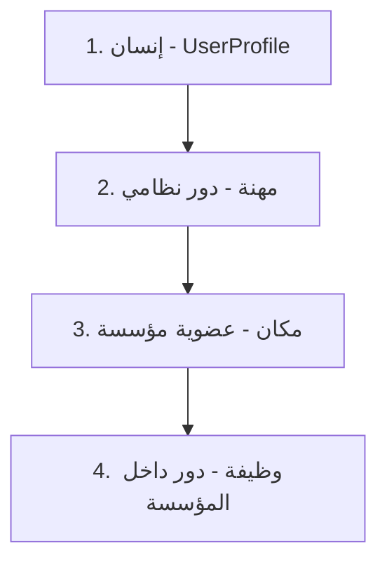
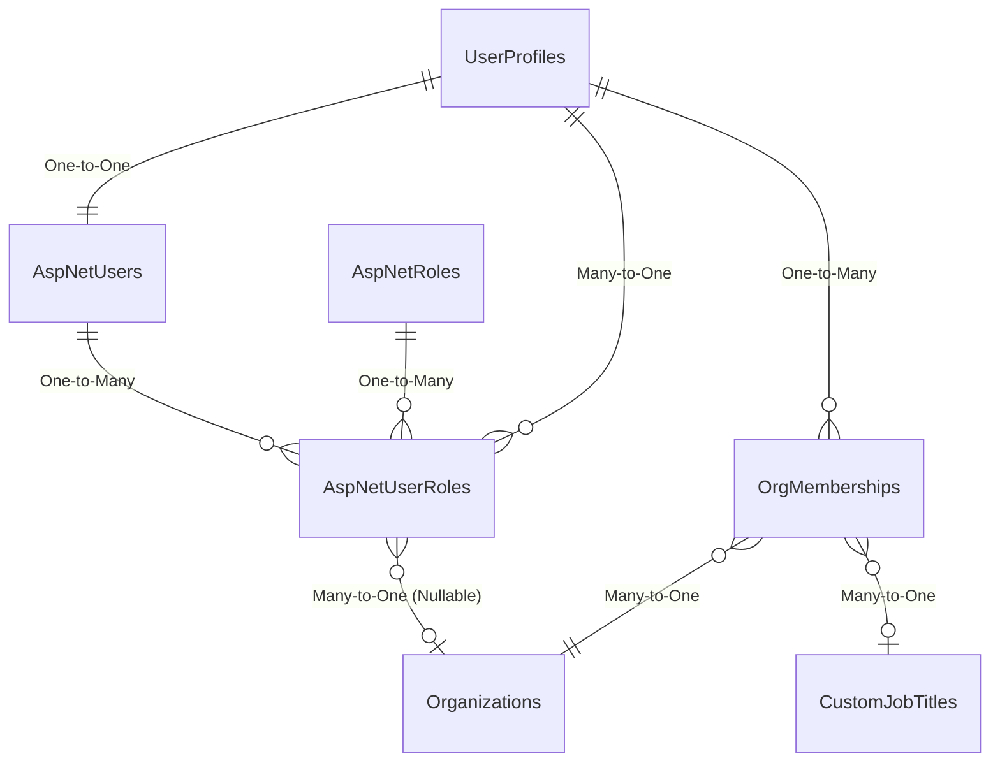
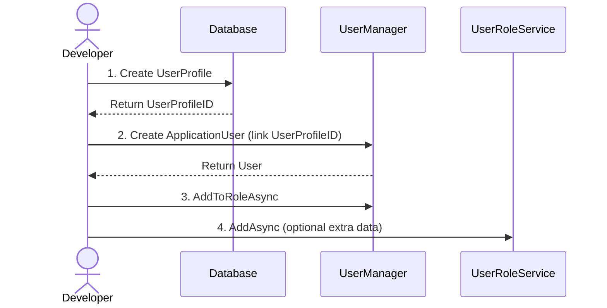

# 02 — IDENTITY (نظام الهوية والمصادقة)

**الإصدار:** 2.0 (Unified Edition)
**آخر تحديث:** 16 أكتوبر 2026
**الحالة:** ✅ محدّث — يدمج 02 + 16
**الجمهور:** فريق التطوير + AI Assistants
**المرجع الإلزامي:** يُقرأ قبل أي تعديل على الهوية أو المصادقة

---

## 📌 الجزء صفر: الفلسفة والرؤية

### 0.1 فلسفة النظام — "الهوية قبل الدور"

> **"الهوية قبل الدور. الإنسان أولاً، ثم المهنة، ثم المكان، ثم الوظيفة."**



### 0.2 التدرج في الخدمات

- **المستوى 0:** مستخدم عادي (قائمة شخصية فقط).
- **المستوى 1:** صاحب مهنة (يمكنه إنشاء مؤسسة غير موثقة).
- **المستوى 2:** مؤسسة موثقة (خدمات متقدمة).

### 0.3 فصل النظام عن المؤسسات

**⚠️ قاعدة جوهرية:**

| النطاق | المسؤولية |
|:---|:---|
| **النظام (RubikCare)** | 3 أدوار نظامية فقط (`Admin`, `Doctor`, `Pharmacist`) |
| **المؤسسات** | تدير موظفيها وأدوارهم الداخلية |

**⚠️ ملاحظة (من جلسة 16 أكتوبر):**

> **"UserRole مخصص فقط لتمييز الطبيب والصيدلي بشكل رئيسي، فهي الأدوار التي تحتاج تراخيص لممارسة مهامها. أما باقي الأدوار فيتم تحديدها حصراً عبر `OrgMembership` + `CustomJobTitle`."**

**⚠️ النظام الحالي (16 أكتوبر):**

- **`Admin`** — يُمنح عبر العضوية في **المنظمة رقم 1** (منصة RubikCare).
- **`Doctor` + `Pharmacist`** — عبر `UserRole` مع `RoleType = Professional` + `ProfessionalLicense`.

---

## 🗄️ الجزء الأول: نموذج البيانات

### 1.1 مخطط العلاقات



### 1.2 `AspNetUsers` (من Microsoft Identity + تعديلاتنا)

| العمود | النوع | الوصف |
|--------|------|-------|
| `Id` | PK, nvarchar(450) | GUID |
| `UserName`, `NormalizedUserName` | nvarchar | |
| `Email`, `NormalizedEmail` | nvarchar | |
| `PasswordHash`, `SecurityStamp` | nvarchar | |
| **`UserProfileID`** | FK → UserProfiles | الرابط إلى البيانات الموسعة ⭐ |
| **`DisplayName`** | nvarchar | اسم العرض ⭐ |
| **`LastActivityDate`** | datetime2 | آخر نشاط ⭐ |
| **`EmailVerificationCode`** | nvarchar | كود التحقق ⭐ |
| **`EmailVerificationCodeExpiry`** | datetime2 | انتهاء الكود ⭐ |

### 1.3 `AspNetRoles` (الأدوار النظامية)

| العمود | النوع | الوصف |
|--------|------|-------|
| `Id` | PK, nvarchar(450) | GUID |
| `Name` | nvarchar | "Admin", "Doctor", "Pharmacist" |
| `NormalizedName` | nvarchar | أحرف كبيرة |

### 1.4 `AspNetUserRoles` (⭐ المعدل والموسع — الأهم)

**⚠️ `UserRole` هو جدول مُوسَّع — للأطباء والصيادلة فقط.**

| العمود | النوع | الوصف |
|--------|-------|-------|
| `UserId` | PK, FK → AspNetUsers | |
| `RoleId` | PK, FK → AspNetRoles | |
| **`UserProfileID`** | FK → UserProfiles | NOT NULL ⭐ |
| **`RoleType`** | nvarchar(50) | "System", "Professional", "Organizational" ⭐ |
| **`ProfessionalLicense`** | nvarchar(100) | ترخيص مهني |
| **`Specialization`** | nvarchar(200) | تخصص فرعي |
| **`IsVerified`** | bit | DEFAULT 0 |
| **`VerifiedDate`** | datetime2 | |
| **`LicenseExpiryDate`** | datetime2 | |
| **`ValidFrom`** | datetime2 | |
| **`ValidTo`** | datetime2 | |
| **`IsActive`** | bit | DEFAULT 1 |
| **`OrganizationID`** | FK → Organizations | إذا كان الدور مرتبط بمؤسسة |
| **`CustomJobTitleID`** | FK → CustomJobTitles | |
| **`SystemJobTitleID`** | FK → SystemJobTitles | |
| **`SpecialityID`** | FK → Specialities | |

**⚠️ ملاحظة حرجة:** جدول `AspNetUserRoles` في DB يحتوي **مسافة زائدة في الاسم** (`AspNetUserRoles `) — دين تقني.

### 1.5 `UserProfiles` (البيانات الموسعة)

| العمود | النوع | الوصف |
|--------|------|-------|
| `UserProfileID` | PK, int | معرف فريد |
| `ApplicationUserId` | FK → AspNetUsers | رابط عكسي (One-to-One) |
| `FirstName`, `LastName` | nvarchar | |
| `FullNameAr`, `FullNameEn` | nvarchar | |
| `NationalID`, `Email`, `PhoneNumber` | nvarchar | |
| `DateOfBirth`, `Gender` | | |
| `ProfilePictureUrl` | nvarchar | |
| `AreaID` | FK → Areas | الموقع الجغرافي |
| `IsActive`, `CreatedDate`, `LastModifiedDate` | | |

### 1.6 `OrgMembership` (العضوية في المنظمة)

**⚠️ هذا الجدول هو أساس الصلاحيات داخل المنظمة.**

| العمود | النوع | الوصف |
|--------|------|-------|
| `OrgMembershipID` | PK, int | |
| `UserProfileID` | FK → UserProfiles | |
| `OrganizationID` | FK → Organizations | |
| **`MembershipType`** | nvarchar(50) | ⚠️ **Deprecated** — 8 قيم ثابتة |
| **`CanManageOrganization`** | bit | ⚠️ **Deprecated** |
| **`CanManageMembers`** | bit | ⚠️ **Deprecated** |
| **`CanManageFinance`** | bit | ⚠️ **Deprecated** |
| **`CanManageServices`** | bit | ⚠️ **Deprecated** |
| **`CanViewReports`** | bit | ⚠️ **Deprecated** |
| `EffectiveFrom`, `EffectiveTo` | datetime2 | |
| `AssignmentReason` | nvarchar(500) | |
| `IsActive` | bit | |
| `AssignedByUserID` | int | |
| `SystemJobTitleID` | int? | |
| `CustomJobTitleID` | int? | |

**⚠️ الحقول المُعلَّمة Deprecated — ستُستبدل بنظام `19-PERMISSIONS` (ControlLevel + Permissions).**

**⚠️ `MemberTitles`** — M:N جديد يُستخدم للمنطق المُوسَّع (نظام الصلاحيات).

### 1.7 `UserRoleService` — القلب النابض لنظام الأدوار

**المسار:** `RubikCare.Application/Services/Identity/UserRoleService.cs`

**المسؤوليات:**

- إدارة `AspNetUserRoles` الموسَّع.
- إدارة الأدوار المهنية (Doctor/Pharmacist).
- التحقق من الصلاحية الزمنية (`ValidFrom`, `ValidTo`).

**الواجهة:**

```csharp
public interface IUserRoleService
{
    IQueryable<UserRole> GetAll();
    Task<UserRole?> GetByIdAsync(string userId, string roleId);
    Task AddAsync(UserRole userRole);
    Task UpdateAsync(UserRole userRole);
    Task DeleteAsync(UserRole userRole);
    Task<List<UserRole>> GetRolesForUserAsync(int userProfileId);
    Task<List<UserRole>> GetUsersInRoleAsync(string roleId);
    Task<bool> ExistsAsync(string userId, string roleId);
    Task<UserProfile?> GetUserProfileWithUserAsync(int userProfileId);
}
```

**التسجيل:**

```csharp
builder.Services.AddScoped<IUserRoleService, UserRoleService>();
```

---

## 🎯 الجزء الثاني: إنشاء مستخدم جديد (التسلسل الإلزامي)

### 2.1 المخطط



### 2.2 الكود التفصيلي

```csharp
// الخطوة 1: إنشاء UserProfile أولاً
var userProfile = new UserProfile
{
    FirstName = "أحمد",
    LastName = "محمد",
    Email = "ahmed@example.com",
    PhoneNumber = "0123456789",
};
_context.UserProfiles.Add(userProfile);
await _context.SaveChangesAsync();  // الآن لدينا UserProfileID

// الخطوة 2: إنشاء ApplicationUser وربطه بـ UserProfileID
var user = new ApplicationUser
{
    UserName = "ahmed@example.com",
    Email = "ahmed@example.com",
    UserProfileID = userProfile.UserProfileID,  // الرابط الحاسم
    PhoneNumber = "0123456789"
};
var result = await _userManager.CreateAsync(user, "Password123!");

if (result.Succeeded)
{
    // الخطوة 3: إضافة الأدوار باستخدام UserManager
    await _userManager.AddToRoleAsync(user, "Doctor");
    
    // الخطوة 4: (اختياري) إضافة بيانات إضافية في UserRole
    var userRole = new UserRole
    {
        UserId = user.Id,
        RoleId = roleId,
        UserProfileID = userProfile.UserProfileID,
        RoleType = "Professional",
        ProfessionalLicense = "MED-12345",
        IsActive = true,
        ValidFrom = DateTime.Now,
        ValidTo = DateTime.Now.AddYears(1)
    };
    await _userRoleService.AddAsync(userRole);
}
```

### 2.3 ⚠️ تحذير حرج

**لا تحاول أبداً إنشاء `ApplicationUser` بدون `UserProfile` أولاً. هذا يكسر العلاقة ويجعل النظام غير قادر على ربط حساب الدخول بالبيانات الموسعة.**

---

## 🔐 الجزء الثالث: Google Sign-In (دمج `16`)

### 3.1 نظرة عامة

**⚠️ من `16-Google-Sign-In-Complete-Guide`:**

| المنصة | التقنية | الحالة |
|--------|---------|--------|
| **Web (Blazor Server)** | OAuth 2.0 + ASP.NET Core Identity | ✅ يعمل |
| **PWA** | نفس Web | ✅ يعمل |
| **Mobile (MAUI)** | WebAuthenticator + PKCE | ✅ يعمل |

### 3.2 الملفات المتعلقة

| الملف | المسار | الدور |
|-------|--------|-------|
| `Program.cs` | `Rubikcare.Web/` | تسجيل Google OAuth |
| `IGoogleRegistrationService.cs` | `RubikCare.Application/Interfaces/Auth/` | واجهة الخدمة الموحدة |
| `GoogleRegistrationService.cs` | `RubikCare.Application/Services/Auth/` | تنفيذ الخدمة |
| `ExternalLogin.razor` | `Rubikcare.Web/Components/Account/Pages/` | استقبال Callback |
| `Login.razor` | `Rubikcare.Web/Components/Account/Pages/` | زر Google |

### 3.3 إعدادات `Program.cs`

```csharp
var googleClientId = builder.Configuration["Authentication:Google:ClientId"]
    ?? throw new InvalidOperationException("Google ClientId not found");

var googleClientSecret = builder.Configuration["Authentication:Google:ClientSecret"]
    ?? throw new InvalidOperationException("Google ClientSecret not found");

builder.Services.AddAuthentication()
    .AddGoogle(options =>
    {
        options.ClientId = googleClientId;
        options.ClientSecret = googleClientSecret;
        options.CallbackPath = "/signin-google";
        options.CorrelationCookie.SameSite = SameSiteMode.Unspecified;
        options.CorrelationCookie.SecurePolicy = CookieSecurePolicy.Always;
        options.CorrelationCookie.HttpOnly = true;
    });

builder.Services.ConfigureExternalCookie(options =>
{
    options.Cookie.SameSite = SameSiteMode.Unspecified;
    options.Cookie.SecurePolicy = CookieSecurePolicy.Always;
});

builder.Services.ConfigureApplicationCookie(options =>
{
    options.Cookie.SameSite = SameSiteMode.Unspecified;
    options.Cookie.SecurePolicy = CookieSecurePolicy.Always;
});
```

### 3.4 المنطق في `ExternalLogin.razor`

```csharp
protected override async Task OnInitializedAsync()
{
    try
    {
        Input ??= new();

        var info = await SignInManager.GetExternalLoginInfoAsync();
        if (info is null)
        {
            message = T("Error.LoadingInfo");
            return;
        }

        externalLoginInfo = info;
        var email = info.Principal.FindFirstValue(ClaimTypes.Email);

        // 1. محاولة تسجيل دخول مباشر
        var signInResult = await SignInManager.ExternalLoginSignInAsync(
            info.LoginProvider, info.ProviderKey,
            isPersistent: false, bypassTwoFactor: false);

        if (signInResult.Succeeded)
        {
            Logger.LogInformation("✅ Google login succeeded: {Email} at {Time}",
                email, DateTime.Now);
            NavigationManager.NavigateTo(ReturnUrl ?? "/", forceLoad: true);
            return;
        }

        // 2. البريد غير مُفعَّل → تفعيل تلقائي
        if (signInResult.IsNotAllowed)
        {
            var userByLogin = await UserManager.FindByLoginAsync(info.LoginProvider, info.ProviderKey);
            if (userByLogin != null
                && string.Equals(userByLogin.Email, email, StringComparison.OrdinalIgnoreCase))
            {
                if (await GoogleService.AutoConfirmEmailAsync(userByLogin))
                {
                    await SignInManager.SignInAsync(userByLogin, isPersistent: false);
                    Logger.LogInformation("✅ Auto-confirmed and signed in {Email}", email);
                    NavigationManager.NavigateTo(ReturnUrl ?? "/", forceLoad: true);
                    return;
                }
            }
        }

        // 3. ربط Google Login بمستخدم موجود
        var existingUser = await UserManager.FindByEmailAsync(email);
        if (existingUser != null)
        {
            var linked = await GoogleService.LinkGoogleLoginAsync(
                existingUser, info.LoginProvider, info.ProviderKey);

            if (linked)
            {
                await GoogleService.AutoConfirmEmailAsync(existingUser);
                await SignInManager.SignInAsync(existingUser, isPersistent: false);
                Logger.LogInformation("✅ Linked and signed in {Email}", email);
                NavigationManager.NavigateTo(ReturnUrl ?? "/", forceLoad: true);
                return;
            }
        }

        // 4. مستخدم جديد → نموذج إكمال البيانات
        _showRegistrationForm = true;

        var name = info.Principal.FindFirstValue(ClaimTypes.Name) ?? "";
        var nameParts = name.Split(' ');
        Input.FirstName = nameParts.Length > 0 ? nameParts[0] : "";
        Input.LastName = nameParts.Length > 1 ? string.Join(" ", nameParts.Skip(1)) : "";
        Input.Email = email;
    }
    finally
    {
        _isLoading = false;
    }
}
```

### 3.5 الحل الجذري لـ `EmailConfirmed`

في `GoogleRegistrationService.CreateNewUserAsync`:

```csharp
var user = new ApplicationUser
{
    UserName = email,
    Email = email,
    PhoneNumber = phoneNumber,
    EmailConfirmed = true  // ⭐ Google أكد البريد
};

// تأكيد البريد بشكل صريح
var token = await _userManager.GenerateEmailConfirmationTokenAsync(user);
await _userManager.ConfirmEmailAsync(user, token);
```

### 3.6 إعدادات Mobile (MAUI)

**الملفات:**

| الملف | المسار |
|-------|--------|
| `WebAuthenticatorActivity.cs` | `Mobile/Platforms/Android/` |
| `AndroidManifest.xml` | `Mobile/Platforms/Android/` |
| `LoginViewModel.cs` | `Mobile/Features/Auth/ViewModels/` |
| `RubikCare.Mobile.csproj` | `Mobile/` |

**`WebAuthenticatorActivity.cs`:**

```csharp
[Activity(
    NoHistory = true,
    LaunchMode = LaunchMode.SingleTop,
    Exported = true)]
[IntentFilter(
    new[] { Android.Content.Intent.ActionView },
    Categories = new[]
    {
        Android.Content.Intent.CategoryDefault,
        Android.Content.Intent.CategoryBrowsable
    },
    DataScheme = "com.googleusercontent.apps.369163319733-8229skagomnn7t0j74uuj3ilj5h1635g")]
public class WebAuthenticatorActivity : WebAuthenticatorCallbackActivity
{
}
```

**الـ Redirect URI في `LoginViewModel.cs`:**

```csharp
private readonly string _googleClientId =
    "369163319733-8229skagomnn7t0j74uuj3ilj5h1635g.apps.googleusercontent.com";

private readonly string _googleRedirectUri =
    "com.googleusercontent.apps.369163319733-8229skagomnn7t0j74uuj3ilj5h1635g:/oauth2redirect";
```

---

## 📧 الجزء الرابع: نظام الإيميلات (Failover)

### 4.1 الكلاسات

```csharp
public class ZohoEmailSettings
{
    public string SmtpServer { get; set; } = "smtp.zoho.com";
    public int SmtpPort { get; set; } = 587;
    public string SenderEmail { get; set; } = string.Empty;
    public string SenderName { get; set; } = string.Empty;
    public string Username { get; set; } = string.Empty;
    public string Password { get; set; } = string.Empty;
    public bool EnableSsl { get; set; } = true;
}

public class GmailEmailSettings
{
    public string SmtpServer { get; set; } = "smtp.gmail.com";
    public int SmtpPort { get; set; } = 587;
    public string SenderEmail { get; set; } = string.Empty;
    public string SenderName { get; set; } = string.Empty;
    public string Username { get; set; } = string.Empty;
    public string Password { get; set; } = string.Empty;
    public bool EnableSsl { get; set; } = true;
}
```

### 4.2 `FailoverEmailService`

```csharp
public class FailoverEmailService : IEmailService
{
    private readonly IEmailService _primaryService;
    private readonly IEmailService _backupService;

    public FailoverEmailService(
        [FromKeyedServices("Primary")] IEmailService primary,
        [FromKeyedServices("Backup")] IEmailService backup)
    {
        _primaryService = primary;
        _backupService = backup;
    }

    public async Task<bool> SendVerificationCodeAsync(...)
    {
        var result = await _primaryService.SendVerificationCodeAsync(...);
        if (result) return true;
        return await _backupService.SendVerificationCodeAsync(...);
    }
}
```

---

## 🔴 الجزء الخامس: المشاكل والحلول

### 5.1 مشاكل Google Login

| # | المشكلة | السبب | الحل |
|---|---------|-------|------|
| 1 | زر Google لا يستجيب | `<a href>` داخل `EditForm` | استخدم `<form method="post">` خارج `EditForm` |
| 2 | `AntiforgeryValidationException` | لا يوجد Anti-forgery token | أضف `<AntiforgeryToken />` |
| 3 | `CryptographicException` | Data Protection keys غير ثابتة | `PersistKeysToFileSystem` |
| 4 | `TypeError: Failed to execute 'query' on 'Permissions'` | خطأ في Google GIS Library | تعطيل VS JavaScript Debugging |
| 5 | تسجيل دخول يفتح صفحة بحث | `<data scheme>` مفقود | أضف `DataScheme` في `WebAuthenticatorActivity.cs` |
| 6 | Google Login لا يعود للتطبيق | Manifest + Code مسجلان | احذف من Manifest، ابقِ الكود |
| 7 | `Error 400: invalid_request` | Custom URI Scheme غير مفعّل | فعّله في Google Console |
| 8 | APK لا يُثبَّت | `Exported = false` | غيّر لـ `Exported = true` |

### 5.2 مشاكل `EmailConfirmed = 0`

**الأعراض:**
- المستخدم موجود لكن `ExternalLoginSignInAsync` يفشل.
- النظام يعرض نموذج "إنشاء حساب جديد".
- يفشل لأن البريد مكرر.

**الحل (للمستخدمين الحاليين):**

```sql
-- إصلاح الحسابات المتأثرة
UPDATE AspNetUsers
SET EmailConfirmed = 1
WHERE Id IN (
    SELECT u.Id
    FROM AspNetUsers u
    INNER JOIN AspNetUserLogins l ON l.UserId = u.Id
    WHERE l.LoginProvider = 'Google'
      AND u.EmailConfirmed = 0
);
```

### 5.3 مشاكل VS Debugger

| المشكلة | السبب | الحل |
|---------|-------|------|
| VS يتوقف عند خطأ Google | JavaScript Debugging مفعّل | `Tools → Options → Debugging → General` → إلغاء `Enable JavaScript debugging for ASP.NET` |
| SignalR Circuit ينقطع | توقف VS | نفس الحل |
| Google Login يفشل | Circuit مقطوع | نفس الحل |

---

## 🔐 الجزء السادس: نظام إدارة الجلسات والكاش

### 6.1 `ClearUserCacheUseCase`

**المسار:** `RubikCare.Application/UseCases/User/ClearUserCacheUseCase.cs`

**الوظيفة:**
- يستدعي `UserSessionService.RefreshUserSessionAndCacheAsync(userId)`.
- يمسح كاشات: `UserSession_`, `UserPrefs_`, `UserBasic_`.
- يستدعي `IUserMenuService.ClearCacheAsync(userId)`.

### 6.2 الاستخدام في `AuthController.Logout`

```csharp
[HttpPost("logout")]
[Authorize]
public async Task<IActionResult> Logout([FromServices] ClearUserCacheUseCase clearCache)
{
    var userId = User.FindFirst("userId")?.Value;
    if (!string.IsNullOrEmpty(userId))
        await clearCache.ExecuteAsync(userId);
    await _signInManager.SignOutAsync();
    return Ok(new { success = true, message = "تم تسجيل الخروج بنجاح" });
}
```

### 6.3 طبقات الكاش

| الطبقة | المسؤول | المفاتيح | المدة |
|--------|---------|----------|-------|
| Session | `UserSessionService` | `UserSession_{userId}` | ساعتين |
| Preferences | `UserSessionService` | `UserPrefs_{userId}` | ساعة |
| BasicInfo | `UserSessionService` | `UserBasic_{userId}` | ساعة |

### 6.4 ملاحظات هامة

- **الموبايل:** `CachedUserSessionService` تدير كاش محلي (`_cachedSession`) يجب مسحه عند Logout.
- **الويب:** `DynamicMenuService` لم تعد تستخدم `IMemoryCache` منفصل.
- **Logout:** يجب أن يمسح الكاش على الخادم وعلى العميل.

---

## 🔍 الجزء السابع: قواعد صارمة

### 7.1 🔴 ممنوعات مطلقة

- **لا تعدل `AspNetUserRoles` يدوياً في قاعدة البيانات أبداً.** استخدم `UserRoleService` أو `UserManager`.
- **لا تحذف `AspNetUsers` بدون حذف `UserProfiles` أولاً** (أو العكس). التسلسل مهم.
- **لا تستخدم `[Key]` في `UserRole.cs`** — المفتاح مركب (`UserId`, `RoleId`) ويتم تعريفه في `OnModelCreating`.
- **لا تغير أنواع مفاتيح Identity** (تبقى `nvarchar(450)`).

### 7.2 🟡 إجراءات تتطلب حذراً

| الإجراء | الصحيح | الخطأ |
|---------|--------|-------|
| إضافة مستخدم | `UserProfile` ← `ApplicationUser` ← أدوار | إنشاء `ApplicationUser` بدون `UserProfile` |
| حذف مستخدم | أدوار ← عضويات ← `AspNetUser` ← `UserProfile` | الحذف العشوائي |
| تعديل دور | استخدم `UpdateAsync` في `UserRoleService` | التعديل المباشر على `AspNetUserRoles` |

### 7.3 🔵 أفضل الممارسات

- استخدم `UserRoleService` لكل العمليات على `AspNetUserRoles`.
- استخدم `UserManager` لعمليات Identity الأساسية.
- تحقق من الصلاحية الزمنية دائماً:

```csharp
var isValid = userRole.IsActive && 
              userRole.ValidFrom <= DateTime.Now && 
              (userRole.ValidTo == null || userRole.ValidTo > DateTime.Now);
```

---

## 🎯 الجزء الثامن: قاعدة "التحقق من الخلفية"

### 8.1 عند أي تعديل على Google Login

1. **اختبر في المتصفح العادي.**
2. **اختبر في التصفح الخفي.**
3. **اختبر في الموبايل.**
4. **تحقق من `UnconfirmedGoogleUsers` = 0.**

### 8.2 استعلامات المراقبة

```sql
-- عدد حسابات Google غير المُفعَّلة
SELECT COUNT(*) AS UnconfirmedGoogleUsers
FROM AspNetUsers u
INNER JOIN AspNetUserLogins l ON l.UserId = u.Id
WHERE l.LoginProvider = 'Google'
  AND u.EmailConfirmed = 0;
```

**النتيجة المتوقعة:** **0** — إذا كان الكود يعمل بشكل صحيح.

---

## 🔗 الجزء التاسع: روابط ذات صلة

- [00 — MASTER-INDEX](./00-MASTER-INDEX.md)
- [00B — PROJECT-BACKLOG](./00B-PROJECT-BACKLOG.md)
- [01 — ARCHITECTURE](./01-ARCHITECTURE.md)
- [03 — MENUS](./03-MENUS.md)
- [14 — CACHING](./14-CACHING.md)
- [19 — PERMISSIONS](./19-PERMISSIONS.md)
- [appendix-a-glossary](./appendix-a-glossary.md)

---

## 📝 الجزء العاشر: سجل التغييرات

| الإصدار | التاريخ | التغييرات |
|:---:|:---|:---|
| **1.0** | **18 يوليو 2026** | الإصدار الأولي — `02-identity-system.md` |
| **1.0** | **أكتوبر 2026** | الإصدار الأولي — `16-Google-Sign-In-Complete-Guide.md` |
| **2.0** | **16 أكتوبر 2026** | **`02-IDENTITY` v2.0** — دمج `02` + `16` + ملاحظات جلسة 16 أكتوبر + إشارات `19-PERMISSIONS` |

---

**© 2026 RubikCare — للاستخدام الداخلي**

**نهاية الوثيقة ✅**
```
