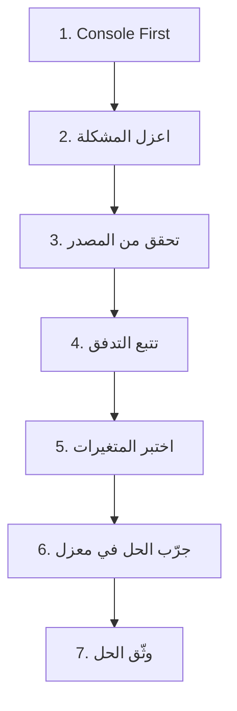

# 16 — TROUBLESHOOTING (منهجية تتبع المشاكل + قواعد AI)

**الإصدار:** 2.0 (Unified Edition)
**آخر تحديث:** 17 أكتوبر 2026
**الحالة:** ✅ مرجع شامل — يدمج 06 + دروس + قواعد AI
**الجمهور:** فريق التطوير + AI Assistants
**المرجع الإلزامي:** يُقرأ قبل أي تشخيص

---

## 📌 الجزء صفر: الفلسفة

### 0.1 المبدأ الأساسي

> **"Console First. لا تغيّر كوداً قبل أن ترى الخطأ."**

### 0.2 المشكلة التي تحلها هذه الوثيقة

في رحلة تطوير روبيك كير، واجهنا العديد من المشاكل التقنية. من مشاكل الترجمة في `ExternalLogin` إلى مشاكل الأداء في الصفحات المترجمة، تعلمنا أن **المشكلة الحقيقية ليست في الخطأ نفسه، بل في كيفية تتبعه وحله**.

**⚠️ هذا المرجع يقدم منهجية موحدة من 7 خطوات يمكن تطبيقها على أي مشكلة.**

### 0.3 فلسفة حل المشاكل: "Console First"

> **قبل أن تغير أي كود، قبل أن تضيف أي سطر، قبل أن تفكر في الحل:**
>
> **⭐ افتح Console المتصفح (F12) ⭐**

**لماذا؟**
- **90% من المشاكل تظهر أخطاءها في Console.**
- **الـ Network Tab يظهر كل طلبات API.**
- **الـ Elements Tab يظهر بنية HTML الفعلية.**

---

## 📋 الجزء الأول: الخطوات السبع الذهبية



### 1.1 الخطوة 1: Console First — ابدأ هنا دائماً

```javascript
// في أي صفحة تواجه مشكلة، ابدأ بهذه الأوامر في Console

// 1. هل هناك أخطاء حمراء؟
// انظر إلى Console مباشرة — أي خطأ أحمر هو دليل مباشر

// 2. هل الدوال المطلوبة موجودة؟
console.log('toggleLanguageSimple:', typeof window.toggleLanguageSimple);
console.log('loginLocalization:', typeof window.loginLocalization);
console.log('updateTranslations:', typeof window.loginLocalization?.updateTranslations);

// 3. هل البيانات المطلوبة موجودة؟
console.log('__initialTranslations:', window.__initialTranslations);
console.log('__currentLang:', window.__currentLang);

// 4. تحقق من Network Tab
// انتقل إلى Network tab -> XHR -> شاهد الطلبات والاستجابات
```

### 1.2 الخطوة 2: اعزل المشكلة — هل هي في Server أم Client؟

#### اختبار API مباشرة

```javascript
// بدلاً من افتراض أن المشكلة في HTML، اختبر API مباشرة

// لصفحات الترجمة
fetch('/api/localization/page/LOGIN?lang=en')
    .then(r => r.json())
    .then(d => console.log('LOGIN API response:', d));

fetch('/api/localization/page/COMMON?lang=en')  
    .then(r => r.json())
    .then(d => console.log('COMMON API response:', d));
```

### 1.3 الخطوة 3: تحقق من البيانات في المصدر (قاعدة البيانات)

```sql
-- 1. هل البيانات موجودة أصلاً؟
SELECT ResourceKey, ResourceValueAr, ResourceValueEn, Module, IsActive
FROM Resources
WHERE ResourceKey IN ('COMMON.SUCCESS', 'LOGIN.TITLE', 'EXTERNAL_LOGIN.VerifiedVia');
```

### 1.4 الخطوة 4: تتبع التدفق — أضف logs في كل خطوة

```csharp
// في الـ Server (C#)
public async Task<Dictionary<string, string>> GetPageTranslationsAsync(string pageDomain, string language)
{
    Console.WriteLine($"📥 GetPageTranslationsAsync called for {pageDomain} in {language}");
    // ... باقي الكود
}
```

### 1.5 الخطوة 5: اختبر المتغيرات المشتركة

```javascript
// في Console
console.log('🔄 localStorage contents:');
console.log('- Language:', localStorage.getItem('RubikCare:Language'));
console.log('- Direction:', localStorage.getItem('RubikCare:Direction'));
console.log('🍪 Cookies:', document.cookie);
console.log('📄 HTML attributes:');
console.log('- lang:', document.documentElement.lang);
console.log('- dir:', document.documentElement.dir);
```

### 1.6 الخطوة 6: جرّب الحل في معزل (Isolate and Test)

```javascript
// جرّب تحديث الترجمة يدوياً في Console
await window.loginLocalization.updateTranslations('en');
```

### 1.7 الخطوة 7: وثّق الحل (Document the Fix)

```
## 📝 سجل المشاكل والحلول

### المشكلة: [تاريخ] [وصف مختصر]
**الخطأ:** [ما الذي كان يحدث؟]
**التشخيص:** [كيف تتبعت المشكلة؟]
**السبب الجذري:** [لماذا حدثت المشكلة؟]
**الحل:** [كيف حُلّت؟]
**الملفات المتأثرة:** [أسماء الملفات]
**الدروس المستفادة:** [كيف نمنع حدوثها مستقبلاً؟]
```

---

## 🧭 الجزء الثاني: نظام الملاحة في MAUI Shell

> **⚠️ ملاحظة:** هذا القسم مُستخلَص من `10-MAUI` + `11-BlazorWebView` — ويُوثّق هنا لأن المشاكل متكررة.

### 2.1 📌 القواعد الذهبية لتسجيل الصفحات

#### 1. الصفحات الرئيسية (Root Pages) — 6 صفحات فقط

| الصفحة | Route | الملف |
|--------|-------|-------|
| تسجيل الدخول | `LoginPage` | `AppShell.xaml` |
| إنشاء حساب | `RegisterPage` | `AppShell.xaml` |
| الرئيسية (Personal) | `MainDashboard` | `AppShell.xaml` |
| لوحة العيادة | `ClinicDashboardPage` | `AppShell.xaml` |
| لوحة الصيدلية | `PharmacyDashboardPage` | `AppShell.xaml` |
| لوحة شركة الأدوية | `PharmaCompanyDashboardPage` | `AppShell.xaml` |

**تسجل في:** `AppShell.xaml` **فقط** كـ `<ShellContent>`.
**تستدعى بـ:** `//Route` (شرطتان مائلتان).

#### 2. الصفحات الفرعية (Detail Pages) — كل ما عدا الستة

**تسجل في:** `AppShell.xaml.cs` **فقط** باستخدام `Routing.RegisterRoute`.
**تستدعى بـ:** `Route` (بدون شرطات).

#### 3. جدول أنواع التنقل الكامل

| الرمز | النوع | التأثير | يستخدم مع | مثال |
|-------|-------|---------|-----------|------|
| `//Route` | Absolute | يستبدل الصفحة الحالية في المكدس | الصفحات الرئيسية | `//MainDashboard` |
| `///Route` | Absolute كامل | يمسح المكدس بالكامل | ❌ ممنوع الاستخدام | - |
| `Route` | Relative | يضيف صفحة فوق المكدس | الصفحات الفرعية | `doctorprofile` |
| `..` | Back | يرجع صفحة للخلف | أي صفحة | `..` |
| `Route?param=value` | Relative + معاملات | يضيف صفحة مع بيانات | الصفحات الفرعية | `doctorprofile?clinicId=5` |

### 2.2 🔴 أخطاء التنقل الشائعة

#### الخطأ 1: `Ambiguous routes matched for...`

**الرسالة:**
```
System.ArgumentException: Ambiguous routes matched for: 
//.../pageName matches found: //.../pageName, //.../pageName
```

**ماذا يعني:** الصفحة مسجلة مرتين - في `AppShell.xaml` و `AppShell.xaml.cs` معاً.

**الحل:** احذف التسجيل من أحد الملفين.

#### الخطأ 2: `JavaProxyThrowable`

**الرسالة:**
```
Android.Runtime.JavaProxyThrowable: Exception of type 
'Android.Runtime.JavaProxyThrowable' was thrown.
```

**متى يظهر:** عند العودة من صفحة إلى أخرى (زر الرجوع).

**الأسباب المحتملة:**
1. تعارض إصدارات `WebView.Maui` مع `MAUI.Controls` (الأكثر شيوعاً).
2. `Ambiguous Routes` (يظهر معه في نفس الوقت).

**الحل:** تأكد من تطابق إصدارات MAUI في `.csproj`.

#### الخطأ 3: `No view found for id 0x7f0800ff (jumpToEnd)`

**الرسالة:**
```
Java.Lang.IllegalArgumentException: No view found for id 0x7f0800ff 
(jumpToEnd) for fragment NavigationRootManager_ElementBasedFragment
```

**متى يظهر:** بعد Splash Screen مباشرة، قبل تحميل أي صفحة. التطبيق ينهار فوراً.

**ماذا يعني:** استخدام `///` مع صفحة رئيسية أدى إلى تدمير `Fragment` الداخلي لـ Shell نفسه.

**الحل:**
1. استبدل كل `///Route` بـ `//Route` للصفحات الرئيسية.
2. استبدل كل مسار نسبي لصفحة رئيسية بـ `//Route`.
3. نفذ تنظيف عميق.

#### الخطأ 4: `Global routes currently cannot be the only page on the stack`

**الحل:** احذف `//` واستخدم المسار النسبي فقط.

#### الخطأ 5: `unable to figure out route for...`

**الحل:** تحقق من `Routing.RegisterRoute` في `AppShell.xaml.cs`.

### 2.3 📊 مصفوفة التشخيص السريع

| الخطأ | أول ملف تراجعه | ثاني ملف | ثالث ملف |
|-------|---------------|---------|----------|
| `Ambiguous routes` | `AppShell.xaml` | `AppShell.xaml.cs` | - |
| `JavaProxyThrowable` | `AppShell.xaml.cs` | `.csproj` | `AppShell.xaml` |
| `jumpToEnd` | `AppShellViewModel.cs` | `AppShell.xaml` | `AppShell.xaml.cs` |
| `Global routes...` | `ViewModel` المعني | `AppShell.xaml.cs` | - |
| `unable to figure out` | `AppShell.xaml.cs` | `ViewModel` المعني | - |

### 2.4 🛡️ إجراءات الوقاية

1. **قبل أي Commit:** تأكد من عدم وجود `///` في المشروع كله.
2. **بعد حذف كود XAML معلق:** تنظيف عميق إجباري.
3. **عند إضافة صفحة جديدة:** اسأل: "هل هي من الـ 6 الرئيسية؟"
4. **القاعدة النهائية:**
   ```
   رئيسية؟ → AppShell.xaml → //Route
   فرعية؟  → AppShell.xaml.cs → Route
   رجوع؟   → ..
   ///     → ممنوع نهائياً
   ```

---

## 🎯 الجزء الثالث: أمثلة تطبيق المنهجية على مشاكل حقيقية

### 3.1 مثال 1: مشكلة الترجمة في صفحة ExternalLogin

| الخطوة | التطبيق |
|---------|----------|
| **1. Console First** | `Uncaught SyntaxError: Invalid or unexpected token` |
| **2. اعزل المشكلة** | `fetch('/api/localization/page/COMMON?lang=en')` ← يعود ببيانات صحيحة |
| **3. تحقق من المصدر** | `SELECT * FROM Resources WHERE ResourceKey LIKE '%SUCCESS%'` ← موجود |
| **4. تتبع التدفق** | أضف logs في `login-localization.js` ← وجدت نسختين متعارفتين |
| **5. اختبر المتغيرات** | `window.__initialTranslations` ← undefined بسبب SyntaxError |
| **6. جرّب الحل في معزل** | أنشئ صفحة HTML تجريبية بنفس الكود ← نفس المشكلة |
| **7. وثّق الحل** | سجلت الحل في سجل المشاكل |

### 3.2 مثال 2: `TypeError: Failed to execute 'query' on 'Permissions'`

**السبب:** `dotnet.js` يستدعي `permissions.query` داخلياً، والخطأ يُلتقط في `try/catch`.

**الحل:**
```
Debug → Windows → Exception Settings (Ctrl+Alt+E)
→ JavaScript Exceptions → إلغاء "Thrown"
```

**النتيجة:** لا يتوقف VS عند First-Chance Exceptions لـ JavaScript.

**⚠️ ملاحظة:** هذا لا يعطل أدوات اكتشاف الأخطاء — بل يصفّيها.

### 3.3 مثال 3: `JavaProxyThrowable` عند زر الرجوع للخلف (Android)

**تاريخ الحل:** 25 مايو 2026

**الأعراض:**
- ضغط زر الرجوع في Android يغلق التطبيق بدلاً من الرجوع للصفحة السابقة.
- عند إعادة فتح التطبيق بعد الإغلاق يظهر الخطأ:
  ```
  Android.Runtime.JavaProxyThrowable
  Method not found: void Microsoft.Maui.LifecycleEvents.LifecycleEventService.RemoveEvent
  ```

**التشخيص:**
الخطأ `Method not found` يشير إلى أن حزمة `Microsoft.AspNetCore.Components.WebView.Maui` تحاول استدعاء دالة `RemoveEvent` في `LifecycleEventService` غير موجودة في إصدار `Microsoft.Maui.Controls` المثبت.

**السبب:** تعارض إصدارات حزم MAUI:
- `Microsoft.Maui.Controls` = 10.0.20
- `Microsoft.AspNetCore.Components.WebView.Maui` = 10.0.51 ← إصدار مختلف

**الحل:** توحيد إصدار `WebView.Maui` مع `Microsoft.Maui.Controls` في ملف `.csproj`:
```xml
<PackageReference Include="Microsoft.Maui.Controls" Version="10.0.20" />
<PackageReference Include="Microsoft.AspNetCore.Components.WebView.Maui" Version="10.0.20" />
```

**القاعدة الذهبية:**
`Microsoft.AspNetCore.Components.WebView.Maui` يجب أن يكون دائماً على نفس إصدار `Microsoft.Maui.Controls`.

### 3.4 مثال 4: `Ambiguous Routes` (تضارب المسارات) في MAUI Shell

**تاريخ الحل:** 26 مايو 2026

**الخطأ:**
```
System.ArgumentException: Ambiguous routes matched for: 
//.../pageName matches found: //.../pageName, //.../pageName
```

**الأعراض:** يحدث هذا الخطأ غالباً مع `JavaProxyThrowable` عند محاولة العودة إلى صفحة سابقة.

**التشخيص:**
1. افحص `AppShell.xaml` و `AppShell.xaml.cs`.
2. إذا وجدت نفس الصفحة مسجلة في كليهما، فهذا هو السبب.

**السبب الجذري:** تسجيل نفس الصفحة (Route) في كل من `ShellContent` داخل `AppShell.xaml` و `Routing.RegisterRoute` في `AppShell.xaml.cs`.

**الحل:** اعتماد هيكلة صارمة للملاحة:
- الصفحات الرئيسية (Root) تسجل في `AppShell.xaml` فقط.
- كل ما عداها يسجل في `AppShell.xaml.cs`.

**الوقاية:** عند إضافة أي صفحة جديدة، اسأل نفسك: "هل هي صفحة رئيسية (Root)؟" إذا كانت الإجابة لا، سجلها في `AppShell.xaml.cs` فقط.

---

## ⚠️ الجزء الرابع: تحذيرات ومحاذير

### 4.1 🔴 ممنوعات مطلقة أثناء حل المشاكل

1. **لا تغير الكود عشوائياً** — كل تغيير يجب أن يكون مبنياً على تشخيص.
2. **لا تحذف ملفات الـ Migration** — استخدم `Add-Migration` جديد.
3. **لا تعدل قاعدة البيانات مباشرة** — استخدم Code-First.
4. **لا تهمل Console** — 90% من المشاكل تظهر هناك أولاً.

### 4.2 🟡 ممارسات سيئة

| الممارسة السيئة | لماذا؟ | الأفضل |
|-----------------|--------|--------|
| "أظن أن المشكلة في كذا" | بدون دليل | اختبر الفرضية أولاً |
| تغيير 10 أسطر دفعة واحدة | لا تعرف أي سطر حل المشكلة | غيّر سطراً واحداً واختبر |
| إضافة `!important` عشوائياً | يسبب مشاكل توريث لاحقاً | ابحث عن السبب الحقيقي |
| تجاهل Cache المتصفح | قد تحل المشكلة وحدها | `Ctrl+Shift+R` للتحديث الكامل |

### 4.3 🔴 قاعدة "الاستنتاج من السياق"

> **قبل افتراض عطل في البنية التحتية (API, CSS, DB, Services)، راجع الأدلة الفعلية في السياق. إذا كان هناك دليل على عمل شيء، فلا تفترض عطلاً فيه. عند الشك، اسأل المستخدم للتأكيد قبل اقتراح حل. إذا كان الكود يعمل في سياق واحد ويفشل في آخر، ابحث في الفارق بين السياقين أولاً.**

---

## 📚 الجزء الخامس: أدوات التشخيص الموصى بها

| الأداة | الاستخدام | اختصار |
|--------|-----------|--------|
| **Console (F12)** | الأخطاء، logs، اختبار الدوال | `F12` ← Console |
| **Network Tab** | مراقبة طلبات API، وقت الاستجابة | `F12` ← Network |
| **Elements Tab** | فحص بنية HTML، الـ CSS المطبق | `F12` ← Elements |
| **Application Tab** | localStorage، cookies، session | `F12` ← Application |
| **SQL Server Profiler** | تتبع استعلامات قاعدة البيانات | أدوات SQL Server |
| **Postman** | اختبار APIs بمعزل عن التطبيق | تطبيق منفصل |
| **Chrome DevTools** | Mobile Debugging | `chrome://inspect` |

---

## ✅ الجزء السادس: CHECKLIST عند مواجهة أي مشكلة

- [ ] **الخطوة 1:** فتح Console (F12) ← هل هناك أخطاء حمراء؟
- [ ] **الخطوة 2:** Network Tab ← هل الطلبات تذهب للأماكن الصحيحة؟
- [ ] **الخطوة 3:** Application Tab ← هل localStorage و cookies صحيحة؟
- [ ] **الخطوة 4:** اختبر API مباشرة (fetch في Console).
- [ ] **الخطوة 5:** أضف logs في الكود (Server و Client).
- [ ] **الخطوة 6:** اختبر في صفحة معزولة (isolated).
- [ ] **الخطوة 7:** ابحث عن المشكلة في سجل المشاكل السابقة.
- [ ] **الخطوة 8:** جرّب `Ctrl+Shift+R` (تحديث كامل مع مسح cache).
- [ ] **الخطوة 9:** إذا وجدت الحل، وثّقه فوراً.

---

## 🎯 الجزء السابع: قواعد AI Assistant

### 7.1 القواعد الإلزامية

> **⚠️ هذه القواعد مُلزمة لكل AI Assistant يعمل على مشروع RubikCare.**

| # | القاعدة |
|:-:|:---|
| **1** | **لا تفترض أن ميزة غير موجودة** — راجع `Dark Areas` في `00-MASTER-INDEX` + الوثيقة المرتبطة. |
| **2** | **لا تخمّن حقولاً** — اطلب رؤية Entity أو `SELECT TOP 1 *`. |
| **3** | **ارجع لـ `17-STRATEGIC-ROADMAP`** قبل أي قرار معماري كبير. |
| **4** | **ارجع لـ `03-MENUS`** قبل أي تعديل على القوائم. |
| **5** | **ارجع لـ `06-POINTS`** قبل أي تعديل على النقاط. |
| **6** | **ارجع لـ `11-PAGE-CREATION`** قبل أي كود جديد. |
| **7** | **قاعدة "Stable vs Unstable"** — لا تعيد هيكلة Stable Modules بدون إذن. |
| **8** | **EF Core Code-First** — لا تعديل يدوي على Migration files. |
| **9** | **استخدم `N''` في SQL** — للعربية. |
| **10** | **استخدم `MERGE` بدلاً من `INSERT`/`UPDATE`** — منفصلة. |
| **11** | **قبل كتابة أي كود، اذكر صراحةً:** "أحتاج لرؤية ملف [الاسم] للتأكد من الحقول والعلاقات." |
| **12** | **🔴 قاعدة "الاستنتاج من السياق":** قبل افتراض عطل في البنية التحتية، راجع الأدلة الفعلية في السياق. |
| **13** | **🔴 قواعد العمل خلال الجلسة:** ابدأ كل رد بـ [#رقم] متسلسل، نفّذ خطوة واحدة واضحة في كل رد، ناقش القرارات التقنية المؤثرة واطلب موافقة قبل الكود النهائي. |

### 7.2 قاعدة التقديرات

> **"التقديرات تُبنى على معامل AI (0.3-0.5) + معدل التطوير الفعلي + التعقيد."**

**⚠️ الصيغة:**

```
التقدير = (معامل AI) × (المعدل الفعلي) × (التعقيد)

المعدل الفعلي (من التحليل):
  - Migration بسيط: ~2-4 ساعات
  - Migration متوسط: ~4-8 ساعات
  - Migration معقد: ~1-2 يوم
  - نظام كامل: ~5-15 يوم
```

**⚠️ آلية التتبع:**

`TASK-LOG.md` — في مستودع الوثائق.

| # | المهمة | المُقدَّر | الفعلي | الفارق | ملاحظات |
|:-:|:---|:---:|:---:|:---:|:---|
| 1 | كتابة 03-MENUS | 2-3 ساعات | 3 دقائق | -97% | AI يُسرّع |
| 2 | نظام النقاط (كامل) | — | 17 يوم | — | — |
| 3 | نظام التقارير | — | 1 يوم | — | — |

**⚠️ المراجعة الأسبوعية:** حساب المعامل الفعلي.

### 7.3 قاعدة الوثائق

> **"الوثائق تُحدَّث أسبوعياً — لا يومياً. الوثائق الحرجة (00, 03, 09) تُحدَّث فوراً. سكريبتات توليد تلقائي للوثائق المُشتقة (migrations list, endpoints)."**

### 7.4 قاعدة قرارات Schema

> **"كل قرار Schema لا يمكن التراجع عنه لاحقاً: يُؤسَّس الآن (Domain + Migrations). لا يُفعَّل (بلا UI, بلا Backend). يُوثَّق في الوثائق."**

**السبب:** تجنّب Migration مع بيانات تشغيلية.

### 7.5 عند الغموض

| السؤال | الإجراء |
|:---|:---|
| **هل هذه الميزة موجودة؟** | **اسأل + راجع الـ Dark Areas** |
| **ما هو الملف الفعلي؟** | **اطلب الرؤية** |
| **ما هي الحقول؟** | **اطلب `SELECT TOP 1 * FROM Table`** |
| **ما هو النمط المعماري؟** | **راجع `01` + `11` + `03`** |

---

## 📝 الجزء الثامن: سجل المشاكل المحلولة

### 8.1 Sprint سابق (8 سبتمبر 2026)

| # | المهمة | الحل |
|---|--------|------|
| 1 | توجيه "Next Refill" الخاطئ | تعديل `OrderTracker` |
| 2 | حالة الطلب `???` | `GetStatusTextArabic` |
| 3 | صفحة "دعواتي" | إعادة تصميم |
| 4 | "أقرب الصيدليات" | دمج `OsmPharmacyService` |
| 5 | كاميرا QR في PWA | `QrScannerComponent` |
| 6 | بوابة الصيدلية | Endpoint جديد في `PharmacyController` |

### 8.2 Sprint سبتمبر 2026

| # | المهمة | الحل |
|---|--------|------|
| 7 | المندوب لا يرى برامج شركته | `companyId` parameter |
| 8 | خصومات الميزانية لا تظهر | `PSPStep2_Budget.razor` |
| 9 | حفظ الأدوية بـ `MedicationID = 0` | `OriginalMedicationID ?? PharmaCompanyMedicationID` |
| 10 | `Unsubscribe` endpoint مفقود | `PspController.Unsubscribe.cs` |
| 11 | `PharmaCompanyDashboard` لا يتحدث | `///` في `GoToAsync` (ثم تم استبدالها) |
| 12 | `GetDashboardStats` يعرض أرقام كل الشركات | فلترة بـ `companyProgramIds` |
| 13 | `MyInvitations` و `MyNetwork` بدون فلترة | إضافة `companyId` |

### 8.3 Sprint أكتوبر 2026

| # | المهمة | الحل |
|---|--------|------|
| 14 | نظام النقاط (كامل) | 17 يوم — Backend |
| 15 | توسعة النقاط (M:N) | 10 أيام |
| 16 | نظام التقارير (كامل) | يوم واحد |
| 17 | Web Push Notifications | Service Worker |
| 18 | تحديث `09-API-GUIDE` v2.0 | 39 Controller + 229 Endpoint |
| 19 | كتابة `03-MENUS` v4.0 | مع النصوص الحرفية |
| 20 | السكريبتات التوليدية | 3 سكريبتات |

**⚠️ التفاصيل الكاملة في `00B-PROJECT-BACKLOG`.**

---

## 🔗 الجزء التاسع: روابط ذات صلة

- [00 — MASTER-INDEX](./00-MASTER-INDEX.md)
- [00B — PROJECT-BACKLOG](./00B-PROJECT-BACKLOG.md)
- [01 — ARCHITECTURE](./01-ARCHITECTURE.md)
- [03 — MENUS](./03-MENUS.md)
- [06 — POINTS](./06-POINTS.md)
- [08 — NOTIFICATIONS](./08-NOTIFICATIONS.md)
- [11 — PAGE-CREATION](./11-PAGE-CREATION.md)
- [12 — CACHING](./12-CACHING.md)
- [13 — MAUI](./13-MAUI.md)
- [14 — PWA](./14-PWA.md)
- [15 — DEPLOYMENT](./15-DEPLOYMENT.md)
- [17 — STRATEGIC-ROADMAP](./17-STRATEGIC-ROADMAP.md)

---

## 📝 الجزء العاشر: سجل التغييرات

| الإصدار | التاريخ | التغييرات |
|:---:|:---|:---|
| **1.0** | **6 يونيو 2026** | الإصدار الأولي — `06-troubleshooting-methodology.md` |
| **2.0** | **17 أكتوبر 2026** | **`16-TROUBLESHOOTING` v2.0** — دمج `06` + MAUI Shell Navigation + قواعد AI + الدرس 6+7 + سجل المشاكل |

---

**© 2026 RubikCare — للاستخدام الداخلي**

**نهاية الوثيقة ✅**
```
